<!--
Maintainers: the screenshots in img/ are made by scripts/manual-shots.sh and
are updated only for full releases (x.y.0). See "Updating this manual" at the
end.
-->

# is-alive user manual

A field guide to **is-alive**, the portable network tester for site visits: what every tab does, what every control means, worked examples with real numbers, and what to do when something doesn't look right.

This manual describes **is-alive 0.25.0**. The [wiki](https://github.com/hammerknife404/is-alive/wiki) has a shorter page per tab, and the [follow-along guide](../../FOLLOW-ALONG.md) is a 20-minute walk-through for people new to networking.

## Contents

1. [Introduction](#1-introduction)
2. [Download and first start](#2-download-and-first-start)
3. [The window](#3-the-window)
4. [Ping](#4-ping)
5. [Port Check](#5-port-check)
6. [Traceroute](#6-traceroute)
7. [Subnet Sweep](#7-subnet-sweep)
8. [DNS Lookup](#8-dns-lookup)
9. [Advanced (mail and domain health)](#9-advanced-mail-and-domain-health)
10. [Config Export](#10-config-export)
11. [Map](#11-map)
12. [Notes](#12-notes)
13. [Speed Test](#13-speed-test)
14. [Subnet Calc](#14-subnet-calc)
15. [Results](#15-results)
16. [Settings and themes](#16-settings-and-themes)
17. [Keyboard and mouse](#17-keyboard-and-mouse)
18. [Site Bundle and Claude](#18-site-bundle-and-claude)
19. [Privacy and security](#19-privacy-and-security)
20. [Troubleshooting](#20-troubleshooting)
21. [Glossary](#21-glossary)
22. [Updating this manual](#22-updating-this-manual)

---

## 1. Introduction

is-alive answers the questions you have on a site visit, from one small program:

- **Is it up?** Ping a device, check which services it offers, trace the route to it.
- **What's on this network?** Sweep the subnet for every live device, with names, MAC addresses and vendors.
- **Does the name work?** Look up any DNS record from any resolver, or compare them all.
- **Is the email set up safely?** Check MX, SPF, DMARC, DKIM, blacklists and a dozen more in one go.
- **Is the line good enough for calls?** Measure speed, latency, jitter, loss, bufferbloat and a VoIP quality score.
- **How is it wired?** Read UniFi, SonicWall and Meraki configs offline and draw the network as a map.
- **What did I find?** Keep notes for the visit, collect every result, and export them for a ticket or report.

It is one file: `is-alive.exe` on Windows, `is-alive-x86_64.AppImage` on Linux. There's no installer, it doesn't need administrator rights, and it doesn't send anything anywhere unless you run something (see [Privacy and security](#19-privacy-and-security)).

**Who it's for:** field technicians and anyone who looks after small and medium networks. You don't need to know the theory: each chapter says what to type, what you'll see and what it means.

> **Before you scan someone's network:** Port Check and Subnet Sweep (and the **Full scan**, which includes both) probe other devices. That's normal network testing, but security software can flag it as a scan. Only scan networks you're allowed to test, and tell the site's IT contact first.

---

## 2. Download and first start

### Download

1. Open the [latest release page](https://github.com/hammerknife404/is-alive/releases/latest).
2. Under **Assets**, download the file for your computer:
   - **Windows:** `is-alive.exe`
   - **Linux:** `is-alive-x86_64.AppImage`
3. Optional: each file has a `.sha256` beside it. To check the download wasn't damaged or changed, compare its SHA-256 (Windows PowerShell: `Get-FileHash .\is-alive.exe`; Linux: `sha256sum is-alive-x86_64.AppImage`) with the one in the `.sha256` file.

Put the file anywhere you like: the desktop, a tools folder, a USB stick. It runs from where it is.

### Windows

1. Double-click `is-alive.exe`.
2. The first time, Windows may show a blue box: **"Windows protected your PC"**. This is Microsoft SmartScreen, and it appears for any program that isn't from a large publisher. Click **More info**, then **Run anyway**. Windows remembers the choice for this file.
3. Windows may also show an **"Open File - Security Warning"** box with **Publisher: Unknown Publisher**. Click **Run**. (Untick *Always ask before opening this file* first if you don't want to see it again.)
4. The window opens on the **Ping** tab.

**Why "Unknown Publisher"?** A program shows its publisher only when it's code-signed, and is-alive isn't, so Windows can't name a publisher and shows *Unknown Publisher*. The download is still the one built by the project's GitHub release workflow: the `.sha256` check above confirms you have exactly that file.

The `.exe` carries everything it needs: a fresh Windows 10 or 11 doesn't need the Visual C++ Redistributable or anything else installed.

If the window never appears, see [Troubleshooting → The .exe doesn't open](#the-exe-doesnt-open).

### Linux

The AppImage needs permission to run, once:

- **From the desktop:** right-click the file → **Properties** → **Permissions** → tick **Allow executing file as program**, then double-click it.
- **From a terminal:**

  ```sh
  chmod +x is-alive-x86_64.AppImage
  ./is-alive-x86_64.AppImage
  ```

It runs on any desktop Linux with glibc 2.35 or newer (Ubuntu 22.04, Debian 12, Fedora 36 and later).

### Opening files directly

You can open a config or map file in is-alive straight from your file manager (**Open with → is-alive**), by dragging it onto the window, or from a command line (`is-alive.exe backup.unf`). Files opened this way go to [Config Export](#10-config-export).

### Updates

When is-alive starts, it asks GitHub whether a newer release is out (you can turn this off: see [Settings](#16-settings-and-themes)). If one is, a green **Update: v…** link appears at the bottom right. Clicking it opens that release's download page; nothing is downloaded or installed for you. To update, download the new file and replace the old one. Your settings and notes are kept: they live in your profile folder, not next to the program.

---

## 3. The window

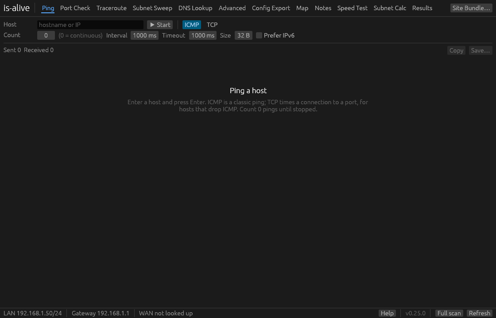

### The tab bar (top)

- **is-alive** (top left) opens **Settings**: theme, network options and the list of shortcuts. See [Settings and themes](#16-settings-and-themes).
- **The tabs:** Ping, Port Check, Traceroute, Subnet Sweep, DNS Lookup, Advanced, Config Export, Map, Notes, Speed Test, Subnet Calc and Results. Hover a tab for what it does and its shortcut (**Ctrl+1** … **Ctrl+9** for the first nine, **Ctrl+0** for Results). In a narrow window the tabs wrap onto a second row.
- **A pulsing dot** on a tab means something is running there. Runs keep going when you switch tabs, so you can start a sweep, look at the map, and come back.
- **Site Bundle…** (top right) zips the visit's results for Claude. See [Site Bundle and Claude](#18-site-bundle-and-claude).

### How every tab is laid out

All the testing tabs work the same way:

1. **The toolbar:** the main field first (Host, Range, Domain…), **▶ Start** right after it, then the options.
2. **The status row** under it: what the run found on the left (counts, loss, time taken), **Copy** and **Save…** on the right. **Copy** puts the result on the clipboard for a ticket or email; **Save…** writes it to a text file.
3. **The results** below. Before the first run, a short explanation says what to do.

**Enter** in the main field starts a run, and **Esc** stops it (so does **■ Stop**, which replaces Start while a run is going). A small spinner turns while it works. Copies and saves confirm themselves with a short message at the bottom of the window.

Every text box has a right-click menu with **Cut**, **Copy**, **Paste** and **Select all**.

**What the boxes accept.** Every text box has a length limit (see [Privacy and security](#19-privacy-and-security)) and quietly drops hidden characters that come along with a paste: control characters, zero-width spaces and the invisible marks that can make one name look like another. A value the box can't use gets a plain message saying why, and the run doesn't start until it's fixed. For example, typing `22,99999` in Port Check's **Ports** says *'99999' isn't a port (1 to 65535)*.

A **Host** box (Ping, Port Check, Traceroute) takes any of these, so you can paste what you have without tidying it first:

| You paste | It uses |
|---|---|
| `printer01`, `google.com` | The name |
| `192.168.1.1`, `2606:4700::1111` | The address |
| `fe80::1%eth0` | An IPv6 link-local address with its zone (the network interface) |
| `[::1]:443`, `nas.local:5001` | The host; in Ping's **TCP** mode the port too, and in Port Check the port replaces the **Ports** list |
| `https://portal.example.com/login` | `portal.example.com` |
| `bücher.de`, `пример.рф` | Names in any language (looked up in their DNS form) |

### The footer (bottom)

- **LAN** is this computer's address and subnet (for example `192.168.1.50/24`).
- **Gateway** is the router this computer sends internet traffic to.
- **WAN** is the public address the internet sees for this network. It's looked up when the app opens (one DNS query to OpenDNS), on **Refresh**, and by a **Full scan**. If you turned that off in Settings it says *not looked up*.
- **Help** (or **F1**) opens the is-alive wiki in your browser.
- **v0.25.0** is the version you're running: worth including when you report a problem.
- **Full scan** runs a quick health check of this network (below).
- **Refresh** reads the LAN and gateway again and looks up the WAN address, for when you've plugged into a different network.

### Full scan

**Full scan** runs five checks at once and opens the **Results** tab to show them:

| Check | What it does |
|---|---|
| Host info | Records this machine's name, LAN, MAC, gateway and WAN, and the is-alive version |
| Ping | 4 pings to the gateway (or to `1.1.1.1` if there's no gateway) |
| Port Check | The gateway's common ports (the **Common** preset) |
| Traceroute | The route to `1.1.1.1`, to show the way out to the internet |
| DNS Lookup | `cloudflare.com` through this computer's own DNS settings |
| Subnet Sweep | Every address on this computer's subnet |

In under a minute you know whether a problem is this computer, the local network, the router or the internet beyond it. Full scan is greyed out while another test is running; stop it or wait. The Speed Test isn't part of it: run that from its own tab.

When every check is done and the sweep found something, the **Map** tab glows for a few seconds (its sweep is on the map now), then keeps a small ring until you open it. If the window is in the background, the glow waits until you come back to it. With **Animate** off (Settings) it lights up briefly instead of pulsing.

### Dropping files

Drag a UniFi backup, SonicWall export or report, Meraki export or `/mapnetwork` map onto the window from any tab. The window darkens to say where it will go, and dropping it opens it in [Config Export](#10-config-export).

---

## 4. Ping

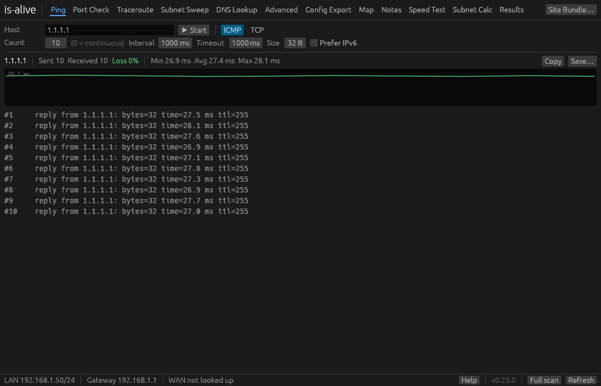

**What it's for:** checking a device answers, how fast, and whether any replies go missing. It's the first test for "the internet is slow" or "the printer is offline".

### Controls

| Control | What it does |
|---|---|
| **Host** | A name (`printer01`, `google.com`) or address (`192.168.1.1`, `2606:4700::1111`) |
| **▶ Start / ■ Stop** | Start the run (or press Enter); stop it (or press Esc) |
| **ICMP / TCP** | **ICMP** is the classic ping. **TCP** times a connection to a port instead, for devices and firewalls that ignore ICMP |
| **Port** | (TCP only) The port to connect to; 443 by default |
| **Count** | How many pings; **0** keeps going until you stop it |
| **Interval** | Time between pings (100 ms to 60 s; default 1000 ms) |
| **Timeout** | How long to wait for each reply before calling it lost (default 1000 ms) |
| **Size** | (ICMP only) The size of each ping's data, in bytes (default 32) |
| **Prefer IPv6** | When a name has both an IPv4 and an IPv6 address, use the IPv6 one |

### Reading the result

- **The status row** shows the address being pinged, **Sent** and **Received**, **Loss** (green at 0%, amber for some loss, red for 100%) and **Min / Avg / Max** round-trip time.
- **The graph** draws each reply as a point on a green line; a red tick is a reply that never came back. The scale in the top left corner is the highest reply time on screen.
- **Each line** is one ping: `#3  reply from 1.1.1.1: bytes=32 time=12.6 ms ttl=57`. (The picture above was taken on a made-up network that answers pings itself, so its replies say `ttl=255`; from a real network, `1.1.1.1` shows around 50 to 60.) Lost ones say *request timed out*, or why: *TTL expired in transit*, *destination unreachable*.

### Example: is the internet connection healthy?

1. Type `1.1.1.1` in **Host** (Cloudflare's public DNS: always on, close to everyone).
2. Set **Count** to `20` and press **Enter**.
3. A healthy wired broadband line looks like this:

   ```
   Sent 20  Received 20  Loss 0%  |  Min 11.8 ms  Avg 12.6 ms  Max 15.1 ms
   ```

How to read it:

| What you see | What it usually means |
|---|---|
| Gateway under 2 ms, `1.1.1.1` 5–40 ms, no loss | Healthy |
| Gateway fine, `1.1.1.1` high or lossy | The problem is the internet line or the provider, not the site |
| Gateway itself slow or lossy | The local network: a bad cable, an overloaded switch, or weak Wi-Fi |
| A flat line with occasional tall spikes | Something fills the line now and then (backups, updates): see [Speed Test → bufferbloat](#bufferbloat-grades) |
| Every reply lost, but the site works in a browser | ICMP is blocked on the way: switch to **TCP** port 443 |
| Max much higher than Avg over Wi-Fi | Normal for Wi-Fi up to a point; for calls, check jitter in the Speed Test |

**Ping the gateway too.** Run the same test against the address after **Gateway** in the footer. Comparing the two tells you which side of the router a problem is on.

### Common problems

- **"could not resolve …"**: the name doesn't exist, or DNS isn't working. Try the address instead, and check the name in [DNS Lookup](#8-dns-lookup).
- **All replies lost to one device, others fine**: many devices (Windows PCs by default, some cameras) don't answer ping. Try **TCP** with a port it serves (3389 for a Windows PC with Remote Desktop, 80 or 443 for a web interface).
- **Linux, every ping fails at once with an error**: see [Troubleshooting → Ping doesn't work on Linux](#ping-doesnt-work-on-linux).

**CSV columns** (when exported from Results): target, mode, port, seq, from, status, rtt_ms, ttl, bytes.

---

## 5. Port Check

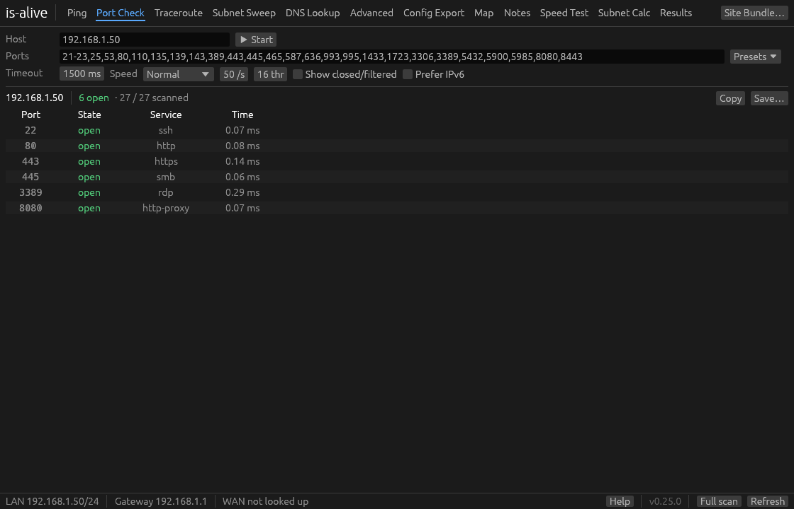

**What it's for:** finding which services a device offers: is the web interface on, is Remote Desktop open, is the mail server listening. It checks TCP ports only.

### Controls

| Control | What it does |
|---|---|
| **Host** | The device's name or address |
| **Ports** | A list and/or ranges: `22,80,443,8000-8100` |
| **Presets ⏷** | Ready-made lists (below); hover one to see its ports |
| **Timeout** | How long to wait for each port (default 1500 ms) |
| **Speed** | How fast to probe: **Gentle**, **Normal** (default), **Fast**, **Unthrottled**. The two numbers beside it are the rate (probes per second, 0 = no limit) and how many run at once; change them by hand for *Custom* |
| **Show closed/filtered** | List every port, not just the open ones |
| **Prefer IPv6** | Use the device's IPv6 address when it has both |

**Presets:**

| Preset | Ports |
|---|---|
| Common (default) | 21–23, 25, 53, 80, 110, 135, 139, 143, 389, 443, 445, 465, 587, 636, 993, 995, 1433, 1723, 3306, 3389, 5432, 5900, 5985, 8080, 8443 |
| Windows / AD | 53, 88, 135, 139, 389, 445, 464, 636, 3268, 3269, 3389, 5985, 5986, 9389 |
| Web | 80, 443, 8000, 8008, 8080, 8443, 8888 |
| Firewall / VPN | 22, 443, 1723, 4433, 8443, 10443 |
| Mail | 25, 110, 143, 465, 587, 993, 995 |
| Well-known 1-1024 | 1–1024 |

**Speed presets:**

| Preset | Rate | At once | 1–1024 ports takes |
|---|---|---|---|
| Gentle | 10 a second | 4 | about 1 min 43 s |
| Normal | 50 a second | 16 | about 21 s |
| Fast | 500 a second | 64 | about 2 s |
| Unthrottled | no limit | 256 | a moment |

Gentle is least likely to set off intrusion detection; Fast and Unthrottled will almost certainly be noticed. No speed makes a scan invisible.

### Reading the result

- **open** (green): something accepted the connection; the **Service** column names what usually runs there, and **Time** is how long the connection took.
- **closed** (red, with *Show closed/filtered*): the device answered "nothing here". The device is up; that service isn't.
- **filtered** (amber): no answer at all before the timeout, usually a firewall dropping it. On Windows a port that times out gets a second try, so one lost packet doesn't read as filtered.
- **error**: the check itself failed (no route, out of resources); the reason shows in red under the status row.

The status row counts **open** ports and how many were scanned; a progress bar shows rate and time left while it runs.

### Example: what does the router offer?

1. Type the gateway's address (from the footer), say `192.168.1.1`, in **Host**.
2. Leave **Ports** on the **Common** preset and press **Enter**.
3. A typical small-office firewall:

   ```
   Port scan of 192.168.1.1 (192.168.1.1)
      53  open      dns
      80  open      http
     443  open      https
   ```

How to read it: DNS (53) means the router answers name lookups for the office; 80 and 443 are its web interface. That's normal from inside. Things worth a note in your report:

| Open port | Why it matters |
|---|---|
| 23 (telnet) | Management with no encryption: passwords cross the network in clear text |
| 80 with no 443 | The web interface has no HTTPS |
| 3389 (rdp), 445 (smb) on a router | Unusual: is a port forwarded, or is this really a server? |
| 4433, 8443, 10443 | Often an SSL-VPN or a firewall's management page: should it be reachable from where you are? |

A device you expect to see with nothing open and every port *filtered* (tick **Show closed/filtered**) is either down or behind a firewall that drops everything.

**CSV columns:** host, ip, port, state, service, rtt_ms, error (closed and filtered ports included).

---

## 6. Traceroute

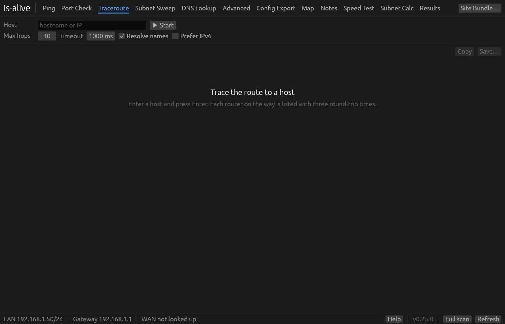

**What it's for:** seeing every router between you and a destination, and where along the way delays or losses start.

### Controls

| Control | What it does |
|---|---|
| **Host** | Where to trace to |
| **Max hops** | Give up after this many routers (1–64, default 30) |
| **Timeout** | How long to wait for each probe (default 1000 ms) |
| **Resolve names** | Look up each router's name (on by default; off is quicker) |
| **Prefer IPv6** | Trace over IPv6 when the destination has both |

Three probes go to each hop. The table shows **Hop**, **RTT 1–3** (the three round-trip times), **Address** and **Name**. The status row says **Tracing** *address*, then **✔ destination reached** or **destination not reached**.

### Example: where is the delay?

Tracing `1.1.1.1` from an office might show:

```
Hop  RTT 1    RTT 2    RTT 3    Address        Name
  1  0.61 ms  0.48 ms  0.52 ms  192.168.1.1    router.lan
  2  8.9 ms   9.4 ms   8.7 ms   100.64.0.1
  3  *        *        *        request timed out
  4  11.2 ms  10.9 ms  11.6 ms  203.0.113.17   core1.example-isp.net
  5  12.1 ms  12.4 ms  11.9 ms  1.1.1.1        one.one.one.one
✔ destination reached
```

How to read it:

- **Hop 1** is the site's own router: it should be well under a few milliseconds on a wire.
- **Hop 2** is usually the provider's first router. A big jump between hop 1 and hop 2 points at the line itself (DSL, cable, wireless, satellite).
- **A row of `*`** is a router that doesn't answer traceroute probes. It's normal if the hops after it answer: only worry when every hop from some point on is `*`.
- **A slow hop followed by fast ones** is not a problem: routers answer traceroute at low priority. Only a rise that carries on to every later hop is real.
- `100.64.x.x` addresses are carrier-grade NAT: the provider shares one public address between many customers, which matters for VPNs and port forwarding.

**CSV columns:** host, ip, hop, address, name, rtt1_ms, rtt2_ms, rtt3_ms, note.

---

## 7. Subnet Sweep

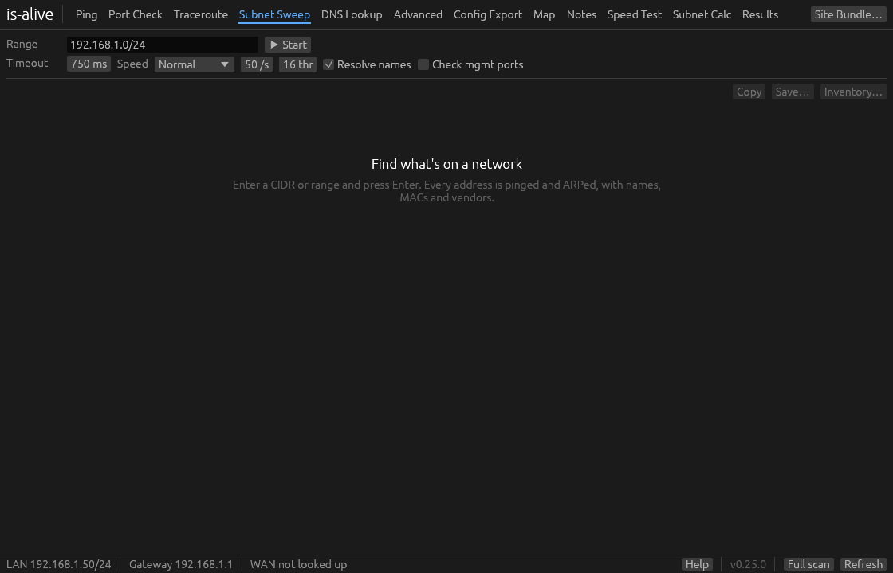

**What it's for:** listing every device that's alive on a network, with its name, MAC address and maker. It also feeds the [Map](#11-map) and the Site Bundle's inventory.

### Controls

| Control | What it does |
|---|---|
| **Ranges** | What to sweep: one network or several. Filled in with this computer's subnet the first time you open the tab. Each can be a subnet (`192.168.1.0/24`, `192.168.1.0 255.255.255.0` or `192.168.1.*`), a short range (`192.168.1.1-254`), a full range (`10.0.0.10-10.0.1.20`, or `10.0.0.10 to 10.0.1.20`) or one address. Separate them with spaces, commas, semicolons or new lines: `10.10.10.0/24 192.168.100.1-50 172.20.5.12 10.0.0.0/28` sweeps all four. Spaces around `-` and `/` and a dash pasted from a document are fine. Beside **Start** it says how many targets and addresses that is (overlaps are swept once), or what's wrong with an entry. Up to 65,536 addresses in all |
| **Timeout** | How long to wait for each address (default 750 ms) |
| **Speed** | As in [Port Check](#5-port-check) |
| **Resolve names** | Look up each device's name (on by default) |
| **Check mgmt ports** | After the sweep, check each live device's management ports (off by default; see below) |
| **Inventory…** | Save the live devices as JSON for Claude's `/mapnetwork` (after a run) |

### How it finds devices

Every address is pinged. On your own network segment, pinging an address also makes this computer ask "who has this address?" (ARP), and almost every device answers that even when it ignores ping. So the sweep also lists devices that answered ARP but not ping: their **Time** says *no ping*, and the status row counts them as *ARP only*. Only devices the computer has just heard from count, not ones that left minutes ago.

Past a router there's no ARP, so on a remote subnet only devices that answer ping are found. Sweeping several networks at once works the same way: your own segment gets ARP and MACs, the others ping only.

**MAC** comes from this computer's ARP table, so only devices on your own segment have one. **Vendor** is the company that registered the first half of the MAC (from a list built into the app, no internet needed). *private/virtual* means a made-up MAC: a phone or laptop using a private Wi-Fi address, or a virtual machine.

**Check mgmt ports** tries ports 22, 23, 80, 443, 445, 541, 554, 3389, 4433, 5000, 8080, 8291, 8443 and 9100 on each live device: the management ports of switches, access points and firewalls, plus a few that give a device's role away (9100 printers, 554 cameras, 3389 Windows). Open ones show in an **Open ports** column and help the Map tell infrastructure from clients. It's a port scan, so it's off unless you tick it.

### Example: what's on the office network?

1. Open **Subnet Sweep**. **Range** already says this computer's subnet, say `192.168.1.0/24`.
2. Tick **Check mgmt ports** (if you're allowed to port-scan this network) and press **Enter**.
3. After a few seconds:

   ```
   Address        Time     TTL  MAC                Vendor              Name           Open ports
   192.168.1.1    0.42 ms  64   fc:ec:da:12:34:56  Ubiquiti Inc        gateway        22, 80, 443
   192.168.1.2    0.88 ms  64   fc:ec:da:65:43:21  Ubiquiti Inc        usw-office     22
   192.168.1.20   1.9 ms   255  3c:2a:f4:aa:bb:cc  Brother Industries  BRN3C2AF4AABBCC 80, 443, 9100
   192.168.1.35   no ping       00:15:5d:01:02:03  Microsoft           frontdesk-pc   445, 3389
   192.168.1.50   0.03 ms  64                      (this machine)      tech-laptop
   ```

How to read it: the gateway and a switch (both Ubiquiti, with SSH open: infrastructure), a Brother printer (9100 is raw printing), and a PC that only showed up because it answered ARP: its firewall drops ping, which is the Windows default. **TTL** hints at the operating system: 64 is usually Linux or network gear, 128 Windows, 255 printers and embedded devices.

### Common problems

- **"No hosts answered"** on a remote subnet: firewalls often drop ping, and ARP doesn't cross routers. Try Port Check on a device you know is there.
- **Fewer devices than expected**: devices asleep, or on another VLAN. A sweep only sees what's reachable from where you're plugged in.
- **Linux, no ARP-only devices**: finding devices that answer ARP but not ping needs the `ip` command (iproute2), present on almost every distribution. MACs come from `/proc/net/arp` and don't need it.

- **"invalid IPv4 address"** beside Start: one of the ranges has a typo; it's named, the rest are fine.

**CSV columns:** range, ip, rtt_ms, ttl, mac, vendor, name, open_ports, found_by (`ping` or `arp`).

---

## 8. DNS Lookup

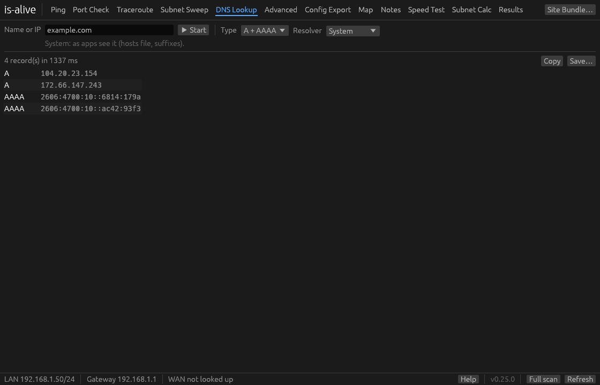

**What it's for:** checking that names turn into the right addresses, seeing any DNS record, and spotting when different DNS servers give different answers.

### Controls

| Control | What it does |
|---|---|
| **Name or IP** | A name (`example.com`) or an address. An address does a reverse lookup (PTR) automatically |
| **Type** | **A + AAAA** (default: the addresses), **All** (every type in turn), or one of A, AAAA, MX, TXT, CNAME, NS, SOA, SRV, CAA, PTR, DS, DNSKEY |
| **Resolver** | Which DNS server to ask (below) |

| Resolver | What it shows |
|---|---|
| **System** | What this computer's apps see, including the hosts file and DNS suffixes |
| **Cloudflare 1.1.1.1**, **Google 8.8.8.8**, **Quad9 9.9.9.9** | What the public internet sees |
| **Authoritative** | The domain's own nameserver: what's published, before any caching |
| **Compare all** | All of the above side by side, with a warning wherever answers differ |

The line under the toolbar reminds you what the chosen resolver means. The status row counts the records and how long it took.

### Example 1: where does a domain's email go?

1. Type `gmail.com`, set **Type** to **MX** and **Resolver** to **Cloudflare 1.1.1.1**, press **Enter**.
2. You'll see five mail servers, each with a priority number (lower is tried first):

   ```
   MX  5 gmail-smtp-in.l.google.com
   MX  10 alt1.gmail-smtp-in.l.google.com
   MX  20 alt2.gmail-smtp-in.l.google.com
   ...
   ```

### Example 2: split DNS ("it works inside but not outside")

1. Type the customer's website or mail name, say `mail.contoso.com`.
2. Set **Type** to **A + AAAA** and **Resolver** to **Compare all**, press **Enter**.
3. If the office's own DNS answers `192.168.1.10` and the public resolvers answer `203.0.113.25`, a yellow note appears for each public resolver: *Cloudflare 1.1.1.1 answers differently from System …*. That's split DNS: inside users reach the server directly, outside users through the firewall. It's fine when it's deliberate, and the cause of "works for me, not for them" when it isn't.

Big websites behind CDNs (Google, Microsoft, Cloudflare) legitimately answer differently from place to place; the note says so. It matters for the customer's own names.

### Common problems

- **"does not exist (NXDOMAIN)"**: the name isn't registered or is misspelled. With **Authoritative**, it means the domain's own server says so.
- **System answers but public resolvers don't**: the name exists only inside (an Active Directory domain, a hosts file entry).
- **Records differ between public resolvers**: a recent change still in caches. The **Authoritative** answer is the new truth; the others catch up as the TTL runs out.

**CSV columns:** lookup, source, type, value (Compare's warnings as type `note`).

---

## 9. Advanced (mail and domain health)

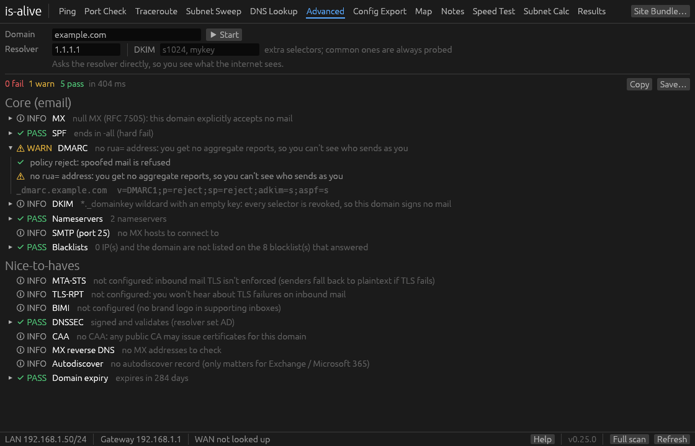

**What it's for:** checking a domain's email and DNS setup the way the rest of the internet sees it: whether mail gets delivered, whether others can send mail pretending to be the domain, and whether anything is broken or about to expire.

### Controls

| Control | What it does |
|---|---|
| **Domain** | The domain. `example.com`, an email address (`user@example.com`) or a web address (`https://www.example.com/page`) all work; it takes the domain out of them |
| **Resolver** | The public DNS server to ask, directly (default `1.1.1.1`; any address works). Asking directly means you see what the internet sees, not this office's DNS |
| **DKIM** | Extra DKIM selectors to try, separated by commas or spaces. The common ones (Microsoft 365, Google, Mailchimp, SendGrid and more) are always tried; hover the hint to see them |

Press **Enter** in any of the three fields to start. All fifteen checks run at once and fill in as they finish, usually within a second or two.

### Reading the result

Each check gets a label:

| Label | Colour | Meaning |
|---|---|---|
| **PASS** ✔ | green | Set up correctly |
| **WARN** ⚠ | amber | Works, but could be safer or more reliable |
| **FAIL** ✖ | red | Broken or missing: worth fixing |
| **INFO** ℹ | grey | For information, not a problem |

The status row counts fail, warn and pass. Each row shows its worst finding; click it to open the rest and the raw records it's based on. Rows with a warning or failure open by themselves.

**Core (email):**

| Check | What it looks at |
|---|---|
| **MX** | Where mail is delivered: missing, broken or unresolvable mail servers; a null MX (the domain takes no mail); Microsoft 365 or Google detected |
| **SPF** | Which servers may send for the domain: missing or duplicate records, the 10-lookup limit, loops, `+all`/`?all`/`~all`/`-all` |
| **DMARC** | What receivers do with forged mail: missing, `p=none` (monitor only), subdomain policy, `pct`, report addresses |
| **DKIM** | Signing keys under the common selectors (and yours): key size, revoked keys, Microsoft 365 CNAMEs with no key behind them |
| **Nameservers** | At least two, each answering for the domain, serial numbers in step, matching the registrar's delegation |
| **SMTP (port 25)** | Connects to the first three mail servers: greeting, STARTTLS, TLS version, certificate, and an open-relay test that stops before any mail is sent |
| **Blacklists** | The domain's own mail servers and SPF addresses, and this network's public address, against Spamhaus, Barracuda, SpamCop and five more; the domain against Spamhaus DBL, URIBL and SURBL |

**Nice-to-haves:** MTA-STS, TLS-RPT, BIMI, DNSSEC, CAA, MX reverse DNS, Autodiscover (for Microsoft 365) and Domain expiry (from the registry, with the registrar and any hold status).

### Example: SPF and DMARC for example.com

1. Type `example.com` in **Domain** and press **Enter**.
2. The result (shown above) is mostly PASS and INFO:
   - **MX: INFO** *null MX (RFC 7505): this domain explicitly accepts no mail*. example.com is set up to say "no email here", and the check recognises it rather than calling it broken.
   - **SPF: PASS** *ends in -all (hard fail)*. The record `v=spf1 -all` lists no servers and ends in `-all`: no server may send as example.com. That's exactly right for a domain that sends no mail.
   - **DMARC: WARN** *no rua= address*. The policy is `p=reject` (PASS: forged mail is refused), but there's no report address, so the owner never hears who tries to send as them.
   - **DKIM: INFO** a wildcard with an empty key: every selector is revoked, so the domain signs no mail. Consistent with the rest.
   - **DNSSEC: PASS**, **Domain expiry: PASS** *expires in … days*.

### What to recommend for a customer's domain

| You see | Plain meaning | Recommend |
|---|---|---|
| SPF **FAIL** *no SPF record* | Anyone can send as the domain undetected | Publish SPF listing the mail provider (e.g. `v=spf1 include:spf.protection.outlook.com -all` for Microsoft 365) |
| SPF **FAIL** *over 10 DNS lookups* | Receivers treat SPF as broken, so it protects nothing | Remove unused `include:`s, or flatten them |
| SPF **WARN** *?all* or no `all` | SPF never fails: no protection | End the record in `~all` or `-all` |
| DMARC **FAIL** *no DMARC record* | Forged mail from the domain is delivered | Start with `v=DMARC1; p=none; rua=mailto:dmarc@domain`, read the reports, then move to `quarantine` and `reject` |
| DMARC **WARN** *policy none* | Monitoring only: forged mail still delivered | Move to `p=quarantine`, then `p=reject`, once the reports show all real mail passes |
| DKIM **WARN** *no active DKIM key found* | The domain's current selector isn't one the app knows | Take the `s=` value from a received email's `DKIM-Signature` header and add it in **DKIM** |
| DKIM **WARN** *1024-bit key* | Weaker than today's standard | Rotate to a 2048-bit key in the mail provider's admin |
| DKIM **FAIL** under 1024 bits | Gmail and others ignore the key: the mail isn't signed as far as they're concerned | Rotate to a 2048-bit key in the mail provider's admin |
| Blacklists **FAIL** | Mail from that address goes to junk or bounces | Find out why it's listed (a compromised account, an open relay), fix it, then ask the list to remove it |
| SMTP **INFO** *probably blocks outbound port 25* | This network can't reach mail servers on port 25: common on office and home lines | Not a problem with the domain. Run it from another network to test SMTP |
| Domain expiry **WARN/FAIL** | The domain is close to expiring, or on hold | Renew it, or check auto-renew and the registrar's contact details |

### Common problems

- **Blacklists: "couldn't check … they refuse public resolvers"**: Spamhaus and URIBL don't answer big public resolvers. Set **Resolver** to the ISP's or the office's own DNS server to include them.
- **"that's an IP address"**: these checks need a domain. For a reverse lookup of an address, use [DNS Lookup](#8-dns-lookup).

**CSV columns:** domain, resolver, section, check, check_status, kind (finding or record), status, text.

---

## 10. Config Export

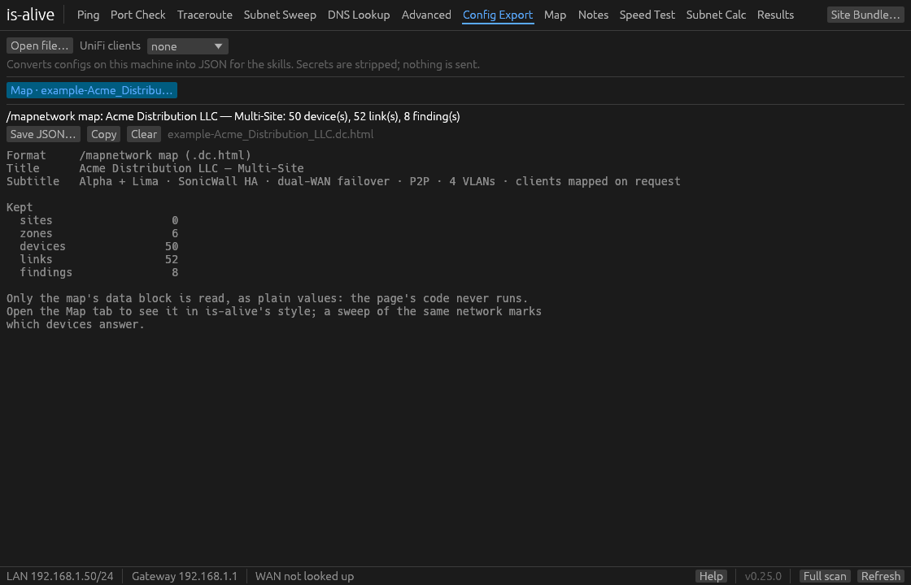

**What it's for:** reading a site's network configuration files on this computer, removing every secret, and turning them into clean JSON for Claude's `/unifidump` and `/mapnetwork` skills. What it reads also draws the [Map](#11-map).

### What it opens

| File | From |
|---|---|
| `.unf` | UniFi Network: a site export or an autobackup |
| `.unifi` | A UniFi OS console backup (UDM, UCG, Cloud Key Gen2) |
| `db.gz`, or a `.zip` holding one of the above | Older or unpacked UniFi backups |
| `.exp` | SonicWall settings export (Gen 6 or 7), or one already decoded to text |
| `.wri` | SonicWall tech support report |
| `.json` | Meraki MX configuration saved from the Dashboard API (see below) |
| `.dc.html`, or a zip holding one | A map made by Claude's `/mapnetwork` |

Open them with **Open file…** (pick several at once if you like), by dropping them on the window from any tab, or with **Open with → is-alive**. Everything happens on this computer: nothing is uploaded.

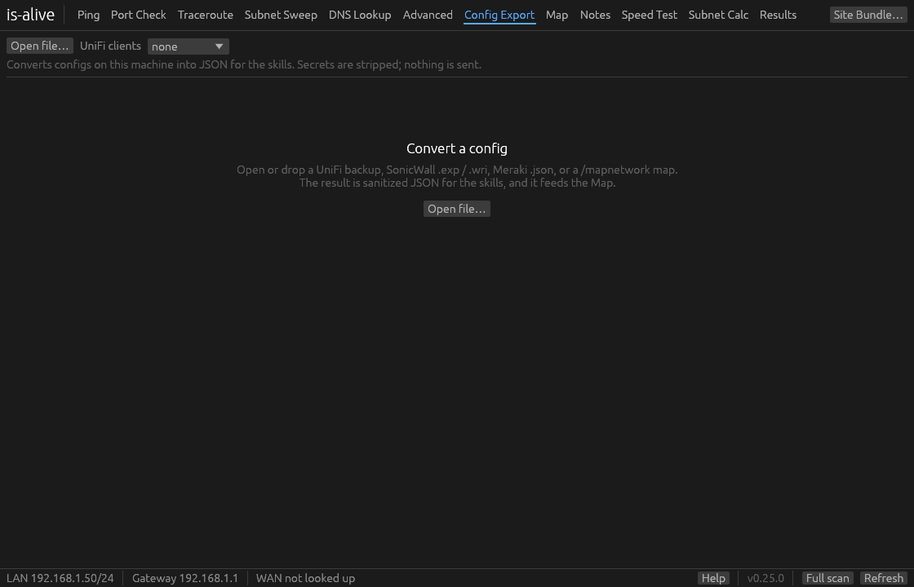

### Controls

| Control | What it does |
|---|---|
| **Open file…** | Pick one or more files |
| **UniFi clients** | Whether a UniFi backup's client list (every device that has connected) goes into the JSON: **none** (default here), **anonymized** (MAC, vendor and switch port kept, names replaced by tokens like `client-1a2b3c4d`), or **full** (real device names, which are often people's names) |
| **The sub-tabs** | One per file, named *kind · file name*. The file opened last is shown; past six, the oldest fold into an **n more** menu |
| **Save JSON…** | Save the sanitized JSON: `<name>.unifidump.json`, `.sonicwall.json`, `.meraki.json` or `.mapnetwork.json` |
| **Copy** | Copy the summary |
| **Clear** | Close this file |

**The summary** under the buttons lists what was read: the layers unpacked, what was kept and how many of each, what was left behind, and every secret field removed. Check it before sharing the JSON. A line such as *🔑 12 secrets from this file hidden in Notes* means those values (Wi-Fi passwords, VPN keys) are held in memory so [Notes](#12-notes) can hide them if they're ever typed or pasted there.

### What's removed

- **UniFi:** only sites, devices, networks, port profiles, Wi-Fi networks and (if you chose) clients are kept. Admin accounts, password hashes, events and everything else are left behind, and any field that holds a password, passphrase, key, token or certificate is removed at any depth. Client notes, email addresses and phone numbers are always dropped.
- **SonicWall:** only named fields are copied (interfaces, zones, address and service objects, access rules, NAT), so accounts, passwords, VPN keys, RADIUS/LDAP secrets, SNMP communities and certificates never leave the file. Comments that mention a password or key are replaced with a placeholder. A tech support report also gives the devices the firewall heard on each port (LLDP), which the Map uses to draw real links.
- **Meraki:** pre-shared keys, VPN, RADIUS and SNMP secrets and PPPoE passwords are never copied.

### Example: preparing a UniFi site for Claude

1. In the UniFi Network app, go to **Settings → System → Backups** and download a backup (`.unf`).
2. Drop it on the is-alive window. Config Export opens with a *UniFi · …* sub-tab.
3. Read the summary: it should list `site`, `device`, `networkconf`, `portconf`, `wlanconf` as kept, and fields like `x_passphrase` as removed.
4. Click **Save JSON…**: it suggests `<name>.unifidump.json`. That file, not the backup, is what you give to `/unifidump`. Or simply use [Site Bundle…](#18-site-bundle-and-claude), which includes it for you.

### Meraki

Meraki keeps its config in the cloud, not on the box. The script [`scripts/meraki-export.ps1`](../../scripts/meraki-export.ps1) saves an organization's configuration to one JSON file using read-only API calls:

```powershell
.\meraki-export.ps1 -Org "Harbor Dental" -Out harbor.meraki.json
```

The API key comes from `MERAKI_DASHBOARD_API_KEY` or a hidden prompt and is never written to disk. Open `harbor.meraki.json` in Config Export. The raw export contains secrets, so share the converted JSON, not the export.

### Common problems

- **"not a UniFi backup …, SonicWall settings export … or /mapnetwork map"**: the file isn't one of the supported kinds, or it's damaged. Check you downloaded the backup itself and not an HTML page.
- **Files larger than 2 GB** are refused, as are files that unpack to more than 2 GB: a real backup is never that big.

---

## 11. Map

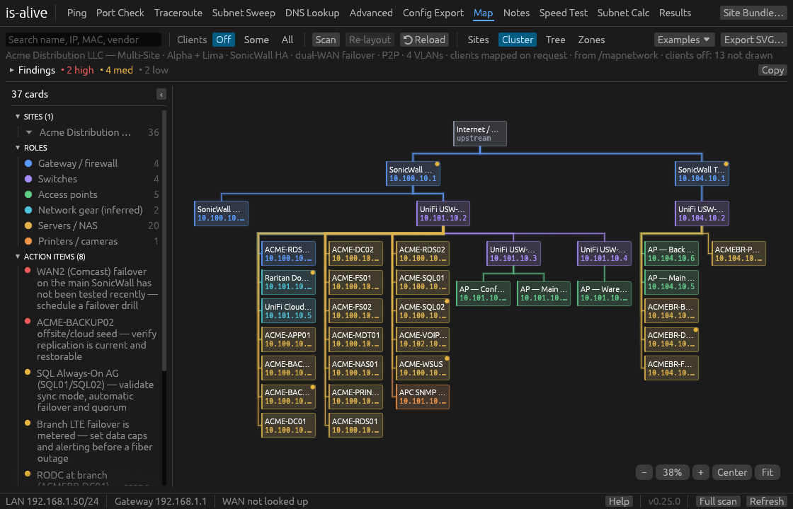

**What it's for:** one picture of the network, built from what is-alive has seen: a sweep, a UniFi backup, a SonicWall export or report, or a map Claude made with `/mapnetwork`. The internet is at the top, then the firewall, switches, access points and servers, each a card coloured by its role.

### Where the map comes from

| Source | What you get |
|---|---|
| **A UniFi backup** (in Config Export) | The real topology: each device under the switch or AP it uplinks to, with the port, wired or wireless |
| **+ a SonicWall export** | The firewall as the gateway, matched by its MAC addresses; a tech support report adds the switches and APs it heard on each port |
| **A sweep alone** | Devices hang under the gateway on dotted *assumed* links, with roles guessed from vendor and open ports (marked *inferred*) |
| **A /mapnetwork map** | Claude's map redrawn in is-alive's style, with its sites, zones, VLANs and findings. A sweep of the same network marks which devices answered, and the hosts the map left out join it as clients, each under the card its subnet hangs off (or under **Not placed**); so do the clients of the site's UniFi backup, under their switch or AP, with names as Config Export left them (tokens when anonymized) |

A map with nothing to show offers **Scan this network** (a sweep of this computer's subnet that fills the map as devices answer), **Open a backup or map…** (opens Config Export), and links to the two example maps and a blank one.

### The toolbar

| Control | What it does |
|---|---|
| **Search** | Find a card by name, IP, MAC, vendor or its note; **Enter** selects the first match |
| **Clients: Off / Some / More / All** | End devices, drawn as small tiles: **Off** shows none; **Some** shows up to 10 under each switch or AP (fewer on a big map) and folds the rest into a **+N more** card; **More** up to 30, on a map of up to 400 cards; **All** gives every client its own card. Named devices, servers, printers, cameras and phones, and anything with a warning, come first. A **+N** chip on a card shows its next 8 clients (Shift+click: all of them), at any level; **−** hides them again. The card stays where it is, so the next click on the same spot shows the next 8. The detail panel of a switch or AP (or of its **+N more** card) has them as buttons |
| **Scan** | Sweep this computer's subnet again and update the map as devices answer |
| **Re-layout** | (After you've dragged cards or boxes) Put every card and box back where the layout had it |
| **⟲ Reload** | Read the map's files from disk again and rebuild, keeping selections and pins |
| **↩ / ↪** | Undo or redo your last change to the map; the tooltip says what (*Undo: move 3 cards*) |
| **Sites / Cluster / Tree / Zones** | The layout (below); your choice is remembered |
| **Legend** | Show or hide the map's legend (below); also **L**, or the background's right-click menu. Your choice is remembered |
| **Examples ⏷** | Open one of two fictional sites, or **Blank map** (the Internet and one gateway at one site, nothing else: a start for a map drawn by hand, or a small map to try things on), or **Close the example** |
| **Export ⏷** | Save the map as it's laid out now (cards where you dragged them, collapsed sites as one card). The file is named after the map. **SVG image**: a picture with the legend (when shown) and the findings under it, sharp at any size. **PNG image**: the same picture at **1×** or **2×**, on the theme's background or on white. **draw.io diagram**: opens in diagrams.net to keep editing, with site boxes as containers and each card's IP, MAC and vendor under *Edit Data*; diagrams.net can also save it as Visio (.vsdx). **Mermaid flowchart**: text that GitHub, GitLab, Azure DevOps, Notion and Obsidian draw in Markdown. **Graphviz DOT**: `dot` lays it out again, `neato -n2` keeps the map's layout. **CSV inventory**: one row per card (name, role, IP, MAC, vendor, site, uplink, port, flags, findings, note) for a spreadsheet. A card's note goes along, redacted: on hover in SVG, draw.io and DOT, in its own CSV column (Mermaid leaves it out) |

**Layouts:**

| Layout | Best for |
|---|---|
| **Cluster** | Most sites: a tree with end devices stacked in columns. A very wide top level (many branch firewalls) wraps into rows |
| **Tree** | Seeing the levels: one row per level, every card side by side (can get wide) |
| **Zones** | Grouping by role: one box per role, with links into a box folded into one counted line |
| **Sites** | Several sites: one box per site, each with its part of the tree. It's the default when the map has two or more sites |

### Moving around

- **Drag the background** to pan; **scroll** or pinch to zoom; the zoom buttons, **Center** and **Fit** sit in the bottom right corner.
- **Double-click the background** to fit the whole map; **double-click a card** to zoom to it.
- **Right-click the background** for **Fit**, **Center**, **Clear selection**, **Re-layout**, **Links** (below), **Legend** and **Export** (the same formats).
- **Drag a card** to move it (dragging one of several selected cards moves them all). Its links follow, and never through another card: nudged a little out of its column, a card stays on the column's line; moved further, its link goes round the cards in the way. Dropped onto other cards' links, it moves them round it the same way.
- **Drag a box by its title** (a role's box in Zones, a site's in Sites) to move it with its cards; cards you dragged out of it come along too. In Zones the folded **×N** line into it follows it; the way into a moved site's box takes its own route, round the cards in its way. **Re-layout** puts boxes back too.
- Zoomed out, cards drop detail lines rather than shrinking the text, so names stay readable. Hover a card for its details.

### Boxes

In **Zones** each role has a box (*Switches*, *Access points*, *Servers / NAS*, *Clients* …); in **Sites** each site does.

- **Click a role box's title** to select all its cards (**Ctrl+click** or **Shift+click** adds them to the selection). A box whose cards are all selected is outlined. A site box's title folds the site instead, as before.
- **Drag the title** to move the box (see *Moving around*). A move is one undo step (*Undo: move the Clients box*) and is kept in saved maps.
- **Right-click the title** for **Select its N cards**, **Add its N cards to the selection**, **Put the box back** (once it's been moved) and **Links**.

### Links

**Right-click the background or a box's title › Links** picks which links the map draws:

| View | Draws |
|---|---|
| **All links** | Every link (the default) |
| **Common links only** | The backbone: links that more than one device's traffic runs over, from the internet to firewalls, switches and access points. A link to an end device (a server, a printer, a laptop) is left out; an access point whose clients aren't drawn but counted on it still counts |
| **Confirmed links only** | The links the data shows (a controller, a firewall, a /mapnetwork map); the grey dotted ones a sweep placed by guess are left out |

A selected card's lit path always shows, whatever the view. While a view other than **All links** is on, a pill in the map's top right corner says which; click it to show all links again. The legend lists only the lines drawn, and **Export ⏷** draws what the map shows. The view is an undo step and is kept in saved maps.

### The legend

The **Legend** panel in the bottom left corner says what everything on the map means, listing only what this map has, with counts:

- **Roles:** each role's colour, as a small card. Click a role to fade those cards out, or back in (as in the left panel).
- **Cards:** the internet, collapsed sites and **+N more** cards, cards *not in the latest data* (red, dashed), pinned cards (📌), the amber **!** of a card with warnings, cards with a note (the small folded sheet), the chips cards carry (an uplink's port, or a tag such as *inferred*), the *drawn* chip of cards drawn by hand on a plan or a training map, and the **+N** and **−** chips of cards with clients to show or hide.
- **Links:** the internet uplink, wired (solid, in the colour of the card it leads to), wireless (dashed), assumed (grey dots: placed by a sweep, not shown by the data), links folded into one line into a box (**×N**), and how a selected card's path lights up.
- **Boxes:** site boxes (Sites) or role boxes (Zones).

Each swatch is drawn exactly as the map draws it. Hover an entry for a word on it. **×** hides the legend; **Legend** in the toolbar, **L** (when no text box has the keyboard) or **Legend** in the background's right-click menu brings it back. **Fit** keeps the map clear of it, above it or beside it, and on a small window it wraps into columns or scrolls. **Export ⏷** puts the same legend under the map in an **SVG** or **PNG** image while it's shown.

### Undo and saved maps

**Undo** (↩, **Ctrl+Z**) and **Redo** (↪, **Ctrl+Shift+Z** or **Ctrl+Y**) step through what you changed by hand: cards or boxes dragged (a whole drag is one step) or put back, **Re-layout**, the **Links** view, the layout, **Clients**, clients shown or hidden on one card (**+N**, **−**, **Show all**), pins, sites collapsed or expanded, roles faded out, notes written, changed or taken off (*Undo: note on ACME-FS01*). Selecting cards isn't a step. The last 100 steps are kept; another map (an example, a file loaded) starts a fresh history.

**Saved maps** keep a map as it is, with your moves, pins, folds and layout, to come back to later. Click **Saved maps** (beside the zoom controls) for the bar along the bottom of the tab; it stays open once a map is saved, and **⏷** hides it.

- **Live** is the map from the sweep and the files loaded now; each saved map has a tab beside it. Click one to open it. A **•** after its name means it has changed since it was saved.
- **+ Save current** saves the map showing as a new tab, ready to be named.
- **Right-click a tab** to **Rename** it, **Update with current** (keep its changes, or replace it with the map showing), **Duplicate**, **Export JSON…** to share it, or **Delete…** it.
- **Open…** (or Config Export, or dropping the file on the window) opens a saved map's `.json`, someone else's too.
- **Right-click a tab › What it is** marks it **As found** (what was discovered on a network), a **Plan** (drawn by hand: a network to build) or **Training** (made up for practice). A plan or a training map says so on its tab, above the map and under the title of an exported picture or draw.io diagram, so it's never taken for what was found; a map saved from the blank example starts as a plan. A card drawn by hand has a *drawn* chip (*drawn link* when only its link up was), in exported pictures and draw.io diagrams too; a client's tile carries no chips, so hover it or open its panel. A training map's answer key is never shown, only how many faults it holds (in the tab's tooltip), and a file made for a purpose this version doesn't know isn't opened.

A saved map doesn't change with the files: **Reload** and **Clients** are greyed out on it, while **Scan** goes back to Live and sweeps. Saved maps are kept in the `maps` folder beside the settings, one `.json` file each.

### Selecting cards

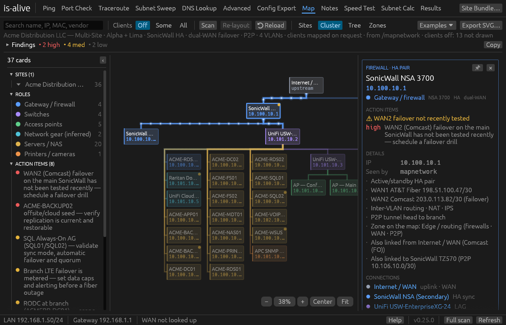

- **Click a card** to select it. Its panel opens on the right, and its whole path up to the internet lights up, with dots flowing along each link: the route its traffic takes.
- A lit link takes the colour of the card it leads to. Where the links to several cards share a line (a column, or the line above a row), it keeps their colour while they share one; where their colours differ, it's in the colour of the card they hang from, and the dots flowing down it take turns in each card's colour (a grey card's dots are hollow rings). Each card's own end of the line is always in its colour. With **Animate** off (in [Settings](#theme)) there are no dots, and the colours alone show the way.
- **Ctrl+click** or **Shift+click** (⌘ on a Mac) adds a card to the selection or takes it out. With several cards selected, only the links that join them light up: two access points on one switch light their two links and that switch; nothing beyond the topmost selected card lights.
- **Esc** clears the selection (pinned cards stay).
- **Trace to WAN**, at the top of the panel, lights every selected card's whole path to the internet instead.

### The right-click menu

Right-click a card, or click **☰** at the top of its section in the panel. Under the card's name (its role and IP in small text), the items come in groups:

| Item | What it does |
|---|---|
| **Pin** / **Unpin** | A pinned card stays selected while you click others, and keeps its place in the panel |
| **Select** / **Select only this card** | Just this card (*Select* when nothing is selected yet) |
| **Add to selection** (Ctrl+click) / **Remove from selection** | Add it to what's selected, or take it out if it's already in |
| **Clear selection** (Esc) | (Several cards selected) Let go of them all; pinned cards stay |
| **Select with its uplink** | This card and the one it hangs off |
| **Select its path to the WAN** | This card and every uplink up to the internet |
| **Select with its direct children** | This card and the cards straight under it |
| **Select with everything below it** | This card and every card under it, all the way down |
| **Add note…** / **Edit note…** / **Remove note** | Write a note on the card, change it or take it off (see *Notes on cards* below). On several selected cards: **Add note to N cards…** puts the same note on each (in place of any they have), and **Remove notes** takes theirs off |
| **Show 8 more clients** / **Show all N clients** (once some show, **Show the other N clients**) / **Hide** or **Fold clients** | (A switch, AP or firewall with clients not drawn, or its **+N more** card) The same as its **+N** and **−** chips: the next few clients, best first, all of them, or back to what **Clients** shows |
| **Ping**, **Port Check**, **Traceroute** | (A card with an IP) The panel's quick check, run on this card: it joins the selection if it wasn't in it (other selected cards stay), and the panel scrolls to the result under **Results** in its section. Greyed out while that check is still running on it |
| **Open in a tab** ▸ | (A card with an IP) A full Ping, Port Check or Traceroute of its IP in that tab |
| **Open web admin** | (Firewalls and gateways, switches, access points and other network gear; servers and devices that have a web page: a NAS, ESXi or Proxmox, iDRAC/iLO/IPMI, a backup appliance, a UPS or PDU card, or any with a web port known to be open) Its web page in your browser: `https://` and its IP, or the port its open ports point to |
| **Copy IP** / **Copy MAC** | (When it has one) The address, shown on the right of the item |
| **Copy details** | Copy the card as text |
| **Put back in the layout** | (A card you've dragged) Back where the layout had it |
| **Collapse / Expand** *site* | (Sites layout, on a map with two or more sites) Fold the card's site into one card, or open it. A long site name is cut short; hover the item for all of it |

Each item shows only when it applies, with how many cards it takes, and a line sets each group apart. Selections made from this menu light only the links that join the selected cards, like Ctrl+click.

**Right-clicking one of several selected cards applies the item to all of them:** the menu says how many, **Pin all N** pins them all, **Copy details of all N** copies them all, **Select only this card** keeps just the one you clicked, and the Select items work from every selected card (for example, *Select their paths to the WAN* on three selected access points selects all three paths). **Ping all N** and **Port Check all N** run the quick check on each selected card with an IP (up to 32 at once; three probe at a time, the rest wait their turn), each result in its own section of the panel; a message says so and the panel scrolls to the first. A card already running that check is left to finish: the item then reads, for example, **Ping the other 2**. **Copy IPs** and **Copy MACs** copy one per line, for pasting into a list of hosts.

**☰ in the panel is the same menu:** the same items, doing the same things, for the card whose ☰ you clicked (all of the selected cards, if there are several). Pick an item, click elsewhere or press **Esc** to close it; **Esc** closes only the menu, not the selection.

### The panel (right)

Each selected card gets a section, newest on top:

- **The role and name**, with **☰** (the card's right-click menu, see above), the 📌 pin button and **×**.
- **Action items:** the card's own warnings and the findings that name it.
- **Details:** IP, MAC, open ports, what saw it (sweep, backup, map), then everything the source said about it.
- **Note:** the note you wrote on it, with **Edit** and **Remove**, and where it's kept (see below). **Add note** in the row of buttons starts one.
- **Connections:** its uplink and what hangs off it; click one to jump to that card.
- **Ping**, **Ports**, **Trace**: a quick check of this device, right in the panel. The short result (`4/4 replies · avg 0.34 ms · 0% loss`, `Open: 22, 80, 443 · 12 closed`) shows under **Results**; click it for the details, **⟲** to run again, **■** to stop, **×** to clear, or **Open in tab** for a full run in that tab. Up to three run at once. These spot checks stay with the card but don't go to the Results tab.
- **Web** (when the device has 443, 8443 or 80 open) opens its web page in your browser. **Copy** copies the card.

With several cards selected, the panel's header says how many and offers **Copy all**. Drag a card's grip (⠿) to reorder; **×** takes a card out of the panel. The panel can be resized from its edge.

### Notes on cards

Write a few lines on a card: where the spare is, who to call before rebooting it, what you changed. **Add note…** on its right-click menu (or ☰), **Add note** in its panel, **N** with one card selected, or a double-click on a card's note mark opens the editor in the card's panel. Up to 2,000 characters, several lines; **Save** (**Ctrl+Enter**) keeps it, **Cancel** (**Esc**) leaves it as it was. Several cards selected: **Add note to N cards…** writes one note onto each.

A card with a note has a small folded sheet on its top edge, at every zoom, and **Has a note** in the legend. Hovering the card shows the note's first lines; **Search** finds it; **Copy details** and the exports carry it.

**Redaction works as in Notes**, with the same lists: select a value in the editor and press **Ctrl+R** (or right-click, **Redact**) to hide it wherever it appears, in Notes too; a secret from a backup loaded in Config Export (a Wi-Fi key, an admin password) is caught by itself. What will be hidden is highlighted, with a count (*🔑 1 redacted: by hand*). **Unredact** keeps a value as written, and a value kept in Notes is kept here too. The note is kept as typed only while is-alive runs: saved maps, the notes kept on this computer, copies, exports, the tooltip and the Site Bundle only ever get the redacted text.

**Where a note is kept**, so it never shows up on another customer's card with the same address (`10.0.0.1` is everywhere):

- **A saved map** keeps its notes in its file, like its other changes: **Update with current** saves them. A value redacted later (by hand, or a backup's secret loaded) is redacted in the file at once, as in `notes.md`; a map opened from a file is kept redacted the same way.
- **An example** keeps them on this computer, with that example. **The blank map** doesn't: it's a start for any site, so its notes last only until is-alive closes or another map starts. Save the map to keep them.
- **The live map** keeps a card's note on this computer by the device's hardware address: its note comes back on any map that shows that device, and on no other card. When a card's address is another device's after a rebuild (another network, or DHCP moved it), the note leaves that card and stays with its own device. A card with no MAC to go by (known only by IP, a randomized address, a shared one such as a router pair's or a firewall HA pair's, a MAC two cards show, this computer) keeps its note only until is-alive closes or another map starts, and a card known only by IP until another sweep starts; its panel says so. **+ Save current** keeps them all in a saved map.

Notes kept on this computer are in `map-notes.json` beside the settings. The **Site Bundle** can carry the live map's card notes (*Card notes*, `card-notes.json`; not an example's).

### The left panel and findings

- **Sites:** each site with a ▾/▸ toggle to collapse or expand it; **Collapse all**, **Expand all**; click a site's name to select its cards and bring it into view. You can also click a site's title on the map.
- **Roles** with counts; click one to fade those cards out.
- **Action items**, worst first; click one to select the devices it's about.
- **‹** hides the panel (the legend still fades roles); **›** brings it back.

**Findings** (the band above the map) come only from evidence: telnet open, management only over plain HTTP, firewall management allowed on a WAN interface, unidentified uplinks, end-of-life models, mixed firmware on one model, devices in the swept range that didn't answer, and more. **Copy** puts them in a ticket.

### Example: walking a site with the Acme example

1. Open the **Map** tab, click **Examples ⏷**, and pick **Acme Distribution: one campus, HA firewalls, dual WAN**.
2. Click the **SonicWall NSA 3700** card. The panel shows it's the primary of an HA pair with a high-priority action item (*WAN2 failover not recently tested*), and the line to the internet lights up.
3. Right-click a server card and choose **Select its path to the WAN**: the switch, firewall and internet link it depends on light up. If that switch failed, everything under it would lose its connection.
4. Switch to **Zones** to see the devices grouped by role, then back to **Cluster**.
5. Open **Examples ⏷** again and pick **Contoso Health: 23 clinics, 81 devices** for a multi-site map in the **Sites** layout. Click a clinic's title to collapse it.
6. **Examples ⏷ → Close the example** goes back to this network's map.

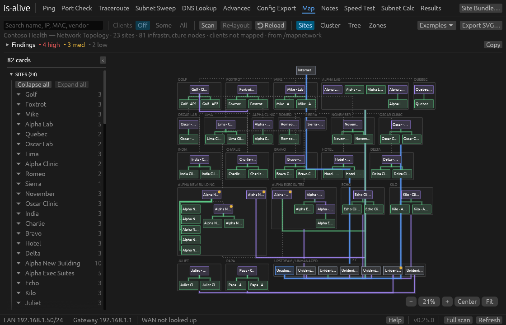

**The accuracy note.** A map built from a sweep and configs is a quick picture, not a survey: a note above it says so and offers **Site Bundle…** for an accurate one from `/mapnetwork`. Its **×** hides it for good; **Settings → Show the accuracy note** brings it back.

**Updating.** The map rebuilds by itself as a sweep finds devices and when a file is loaded in Config Export. Rebuilds keep pins, selections, moved cards and spot-check results. A pinned card that's no longer in the data stays, drawn in red with a dashed outline and marked *Not in the latest data*, so you can check it before unpinning it.

---

## 12. Notes

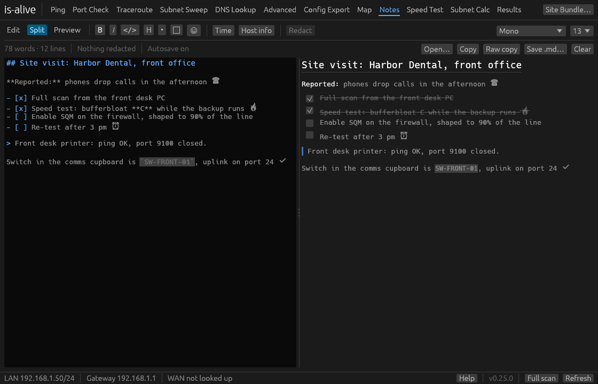

**What it's for:** writing up the visit as you go, in Markdown, saved automatically and kept free of passwords.

### Writing

- **Edit / Split / Preview**: the editor only (default), the editor and the formatted preview side by side, or the preview only. In Split, drag the divider (double-click it for half and half).
- **B**, ***I***, **</>** make the selection bold, italic or code (**Ctrl+B**, **Ctrl+I**); **H** makes the line a heading, **•** a bullet, **☐** a task box you can tick in the preview.
- **Lists continue**: press **Enter** at the end of a list item and the next one starts; Enter on an empty item ends the list.
- **☺** opens the emoji menu, grouped into Status, People, Notes and Tech (a server rack, Wi-Fi, network, firewall, printer, camera, disk and more). Hover an emoji to see what it's for and its shortcode (`:white_check_mark:`, `:fire:`, `:wireless:`); typing the shortcode works too, and Preview draws it as the emoji. The server rack is the file cabinet emoji (🗄, `:file_cabinet:`): Unicode has no server, so other apps show a cabinet.
- **Time** inserts the date and time with the time zone and where this computer's clock syncs from (useful when comparing with device logs). **Host info** inserts this computer's name, domain, LAN, MAC, gateway and WAN.
- **Font and size** (right end of the toolbar): Sans, Mono, and the log-friendly monospace fonts this computer already has; 8 to 32 points.

**Emoji styles.** Emoji are drawn a size up in one of four styles: **Match theme** (monochrome; neon in the Miami and RGB themes), **Monochrome**, **Colour** (each emoji in its own colour: faces yellow, ✅ green, ❌ red) and **Miami neon**. The **Style** row at the top of the emoji menu offers **Same as app** (follows Settings), **Monochrome**, **Colour** and **Miami neon**, for the emoji you insert from then on (with emoji selected, it restyles those too), so one note can mix styles. Emoji inserted in a style of their own keep it. Emoji inserted with **Same as app** follow the **Emoji** setting in Settings, so with *Match theme* they change with the theme.

### Getting it out

The status row under the toolbar shows the word and line count, what's redacted, and the autosave state, with:

| Button | What it does |
|---|---|
| **Open…** | Open a text or config file (up to 5 MB) in a read-only tab beside Notes, with line numbers. It's never saved, redacted or bundled |
| **Copy** | Copy the notes, redacted |
| **Raw copy** | Copy them exactly as written, secrets included (click twice) |
| **Save .md…** | Save as Markdown, redacted, as `notes-<date>.md` |
| **Clear** | Empty the notes (click twice) |

Notes save themselves every couple of seconds to your profile folder (see [Settings](#16-settings-and-themes)) and are there next time you open the app.

### Redaction

Notes never get scanned and mangled: only what you mark, and the secrets of the configs you've opened, are hidden.

- **By hand:** select a password (or anything private) and click **Redact** (**Ctrl+R**). It's hidden there and everywhere else it appears, as a `[🔑 REDACTED: …]` marker. With the cursor on a redacted value, the button becomes **Unredact**. **By hand (n)** lists them, with × to undo.
- **From configs:** every password, pre-shared key and secret that Config Export removed from a loaded backup or export is held in memory and hidden wherever it appears in Notes, so the staff Wi-Fi password can't slip into a note you send.

Autosave, **Copy**, **Save .md…** and the Site Bundle all get the redacted text. Only **Raw copy** gives the original.

Right-click in the editor for Cut, Copy, Paste, Select all, Redact/Unredact and the formatting.

### Example: a visit write-up

```markdown
## Site visit: Harbor Dental, front office

**Reported:** phones drop calls in the afternoon ☎️

- [x] Full scan from the front desk PC
- [x] Speed test: bufferbloat **C** while the backup runs 🔥
- [ ] Enable SQM on the firewall, shaped to 90% of the line
- [ ] Re-test after 3 pm ⏰

Guest Wi-Fi password: Sunny-Harbor-2026
```

Select `Sunny-Harbor-2026` and press **Ctrl+R**: the line becomes `Guest Wi-Fi password: [🔑 REDACTED: …]` in every copy and save, and the status row shows what's hidden.

---

## 13. Speed Test

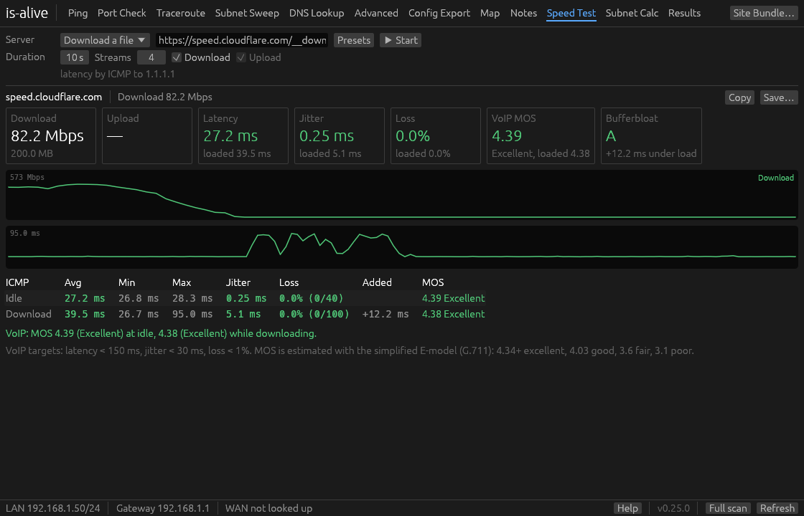

**What it's for:** measuring the line's speed and, more importantly for phones and video calls, how latency, jitter and loss behave when the line is busy.

### Controls

| Control | What it does |
|---|---|
| **Server** | **Download a file** (default): Cloudflare's 25 MB test file, or any large file's direct link. **speed.cloudflare.com**: Cloudflare's full test, download and upload, and it names the data centre and ISP. **Upload to a URL**: posts data to a server that accepts and discards it, such as your own or a LibreSpeed server's `…/backend/empty.php` |
| **Servers ⏷** | Next to the URL for **Download a file** and **Upload to a URL**: free public test servers by region (US East, Central, West, Canada, Europe) from Cloudflare, Hetzner, Vultr, OVH, ThinkBroadband and LibreSpeed hosts. Picking one fills in the URL; the one in use is highlighted, and hovering **Servers** names it |
| **Duration** | Seconds per direction (5–60, default 10) |
| **Streams** | Parallel connections (1–16, default 4; 4 suits most lines) |
| **Download / Upload** | Which directions to test (a file can only be downloaded; an upload URL only uploaded) |

A test runs in three phases: 40 latency probes with the line idle, then the download, then the upload, measuring latency the whole time. The first part of each transfer (1 to 3 seconds of the connection getting up to speed) is left out of the result. When **Download a file** or **Upload to a URL** is used, latency is measured to `1.1.1.1`, so it reads your line rather than the path to that server.

**The test fills the line while it runs.** On a gigabit line that's over 1 GB each way: mind metered or mobile connections, and warn anyone on a call.

### Reading the result

| Figure | Meaning | Good for calls |
|---|---|---|
| **Download / Upload** | Throughput in Mbps, and how much was moved | Enough for the site's users |
| **Latency** | Round-trip time with the line idle; *loaded* is while it's busy | Under 150 ms |
| **Jitter** | How much latency varies from one reply to the next | Under 30 ms |
| **Loss** | Replies that never came back | Under 1% |
| **VoIP MOS** | A call-quality score from latency, jitter and loss (simplified ITU-T G.107 E-model): 4.34+ Excellent, 4.03 Good, 3.6 Fair, 3.1 Poor, below that Bad | 4.0 or more |
| **Bufferbloat** | How much latency rises under load, graded A+ to F (below) | A or A+ |

The table under the graphs gives every figure per phase (Idle, Download, Upload), with **Added** (latency added under load) and **MOS**. Below it, the findings say in plain words what's over target.

### Bufferbloat grades

Bufferbloat is latency that rises when the line is busy, because a router or modem queues too much data. The speed looks fine, but calls break up whenever someone uploads a file or a backup runs.

| Grade | Latency added under load | What it means |
|---|---|---|
| **A+** | under 5 ms | Excellent: no effect on calls |
| **A** | under 30 ms | Good |
| **B** | 30–60 ms | Noticeable on calls when the line is full |
| **C** | 60–200 ms | Calls break up whenever someone fills the line |
| **D** | 200–400 ms | Calls and video unusable under load |
| **F** | 400 ms or more | Severe |

**B or worse gets a finding.** The fix is smart queue management (SQM, also called fq_codel or CAKE) or bandwidth management on the firewall, shaped just below the line's real speed so the queue stays in the firewall, where it's managed.

### Example: why do calls drop in the afternoon?

A run at a dental office where calls drop in the afternoon measured:

- **Download 575 Mbps**: plenty of speed.
- **Latency 27.6 ms** idle, **loaded 97.8 ms**: **+70.2 ms under load**, so **Bufferbloat C**.
- **Jitter 0.44 ms** idle, **65.8 ms** while downloading: over the 30 ms target, so it's called out in red.
- **VoIP MOS 4.39** (Excellent) idle, **4.07** (Good) loaded.

Reading it: the line is fast, and calls are fine while it's quiet. The moment something fills it (an afternoon cloud backup, say), latency jumps by 70 ms and jitter by 65 ms, and calls start to break up. More bandwidth won't fix that; enabling SQM on the firewall, shaped to about 90% of the measured speed, will. Run the test again afterwards: the grade should be A or A+.

### Common problems

- **A direction fails with a 403, or the test is blocked**: web filters (SonicWall Content Filtering, DNS filtering) often block speed test sites, and Cloudflare limits back-to-back tests. Try **Download a file** with a nearby server from **Servers**, or wait a minute.
- **"ICMP got no replies, so latency was measured with TCP connects to port 443"**: ping is blocked on the way; the test carried on with TCP, where loss is less reliable.
- **"IPv6 to … didn't connect, so the test ran over IPv4"**: this network's IPv6 looks broken: it hands out IPv6 addresses but can't route IPv6. Worth fixing (devices will be slow to connect elsewhere too), and the test carries on over IPv4.
- **A link to a download page rather than the file**: the test says so. Use the file's direct link.

**CSV columns:** server, ip, phase (idle/download/upload), mbps, mb, seconds, streams, probe, probes, lost, latency_avg_ms, latency_min_ms, latency_max_ms, jitter_ms, loss_pct, added_ms, mos.

---

## 14. Subnet Calc

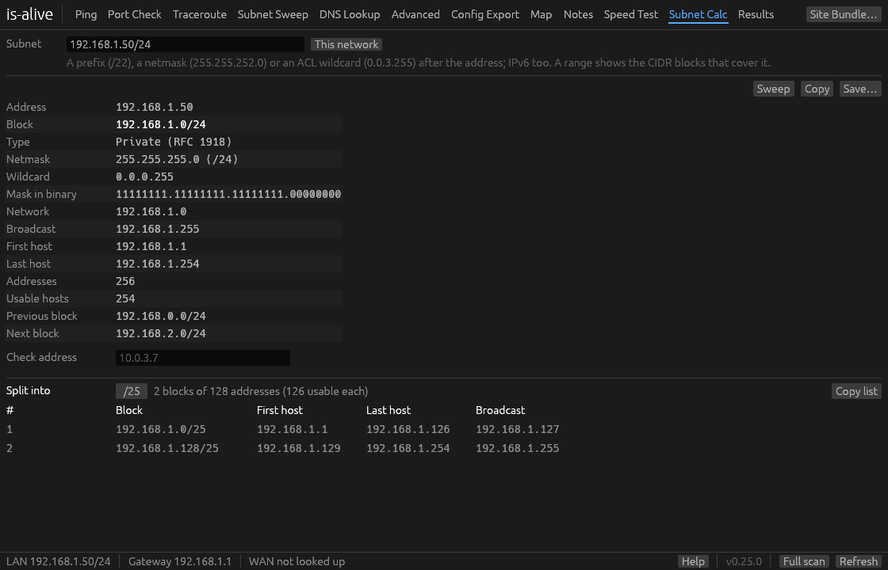

**What it's for:** working out subnets without pen and paper: what a block holds, whether an address is in it, how to split it, and which blocks cover a range. It works offline.

### Controls

| Control | What it does |
|---|---|
| **Subnet** | A block (`10.0.0.0/22`), an address with a netmask (`10.0.0.5 255.255.252.0`) or an ACL wildcard (`10.0.0.5 0.0.3.255`), an IPv6 block (`2001:db8::/48`), or a range (`10.0.0.5-10.0.1.20`). It starts with this computer's subnet |
| **This network** | Put this computer's subnet back in the box |
| **Check address** | Is this address inside the block, and which number is it? |
| **Split into** | Split the block into smaller ones of this size; **Copy list** copies them one per line |
| **Sweep** | Send the block or range to [Subnet Sweep](#7-subnet-sweep) and start it (IPv4, up to 65,536 addresses) |
| **Copy / Save…** | The block's details as text |

**The details:** Address, Block, Type (private, public, CGNAT, link-local, loopback, multicast…), Netmask, Wildcard, Mask in binary, Network, Broadcast, First host, Last host, Addresses, Usable hosts, and the Previous and Next blocks of the same size. Click any value to copy it.

### Example: splitting a /24 for VLANs

A site has `192.168.10.0/24` and needs four VLANs of equal size.

1. Type `192.168.10.0/24` in **Subnet**.
2. Set **Split into** to `/26`. It says *4 blocks of 64 addresses (62 usable each)* and lists them:

   | # | Block | First host | Last host | Broadcast |
   |---|---|---|---|---|
   | 1 | 192.168.10.0/26 | 192.168.10.1 | 192.168.10.62 | 192.168.10.63 |
   | 2 | 192.168.10.64/26 | 192.168.10.65 | 192.168.10.126 | 192.168.10.127 |
   | 3 | 192.168.10.128/26 | 192.168.10.129 | 192.168.10.190 | 192.168.10.191 |
   | 4 | 192.168.10.192/26 | 192.168.10.193 | 192.168.10.254 | 192.168.10.255 |

3. Type `192.168.10.77` in **Check address**: *✔ Inside 192.168.10.0/24 (address #77)*. In the split list, it falls in block 2.

Each VLAN gets one block; its gateway is usually the first host (`.1`, `.65`, `.129`, `.193`), and every VLAN's devices need the mask `255.255.255.192`.

### Example: a firewall rule for a range

A rule must cover `10.0.0.5` to `10.0.1.20`, but the firewall only takes CIDR blocks. Type `10.0.0.5-10.0.1.20`: the fewest blocks that cover it exactly are listed (`10.0.0.5/32`, `10.0.0.6/31`, `10.0.0.8/29`, … `10.0.1.20/32`), ready to copy into an address group.

---

## 15. Results

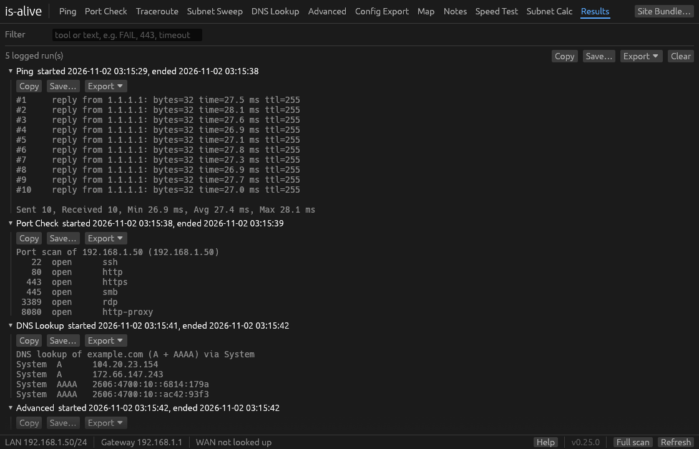

**What it's for:** everything you ran in this session in one place, with start and end times, to copy into a ticket or export for a report.

Every finished run from every tab is logged here (Full scan runs too). Runs still going show at the bottom with *running…*. The 12 newest are open; older ones are folded: click a header to open it.

| Control | What it does |
|---|---|
| **Filter** | Show only runs whose tool name or output contains this text (`FAIL`, `443`, `timeout`, a hostname). × clears it |
| **Copy / Save…** | All shown runs as text |
| **Export ⏷** | All shown runs as **CSV**, **JSON**, **Markdown** or **HTML** |
| **Clear** | Empty the log (click twice) |
| Each run's **Copy**, **Save…**, **Export ⏷** | Just that run |

Copy, Save and Export always follow the filter, so filter to one customer's hosts and export just those.

**CSV** uses each tool's own columns, one row per result, with the run's start time first, so repeated runs stack and filter cleanly in Excel. Exporting several tools at once gives one CSV with a `tool` column. **HTML** gives a report you can attach or print.

**The log lives in memory only:** it's gone when you close the app. Export what you need before closing.

### Example: a report for the ticket

1. After a Full scan and a few tests, open **Results**.
2. Type `FAIL` in **Filter** to see only runs that found a failure, or a hostname to see everything about one device.
3. **Export ⏷ → HTML**, save, and attach it to the ticket.

---

## 16. Settings and themes

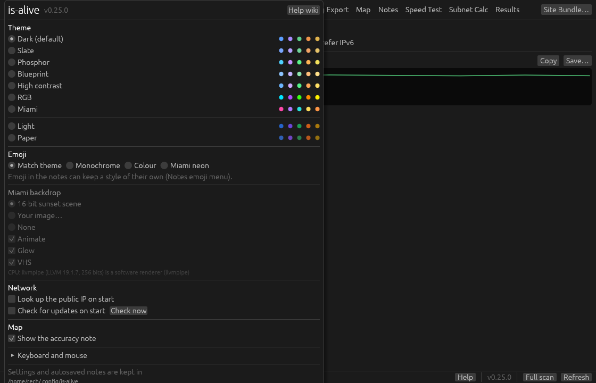

Click **is-alive** at the top left to open Settings. Changes apply at once and are remembered.

### Theme

| Theme | Look |
|---|---|
| **Dark** (default) | Standard dark |
| **Slate** | Soft blue-grey, easy on the eyes |
| **Phosphor** | Green-screen terminal |
| **Blueprint** | White lines on drafting blue |
| **High contrast** | Black and white, bright colours |
| **RGB** | Neon on black, with a rainbow line under the tabs |
| **Miami** | Midnight purple, hot pink and teal, over a 16-bit sunset |
| **Light** | For bright rooms and screenshots in tickets |
| **Paper** | Warm light, like a printed site map |

The dots beside each name are that theme's Map colours for each role.

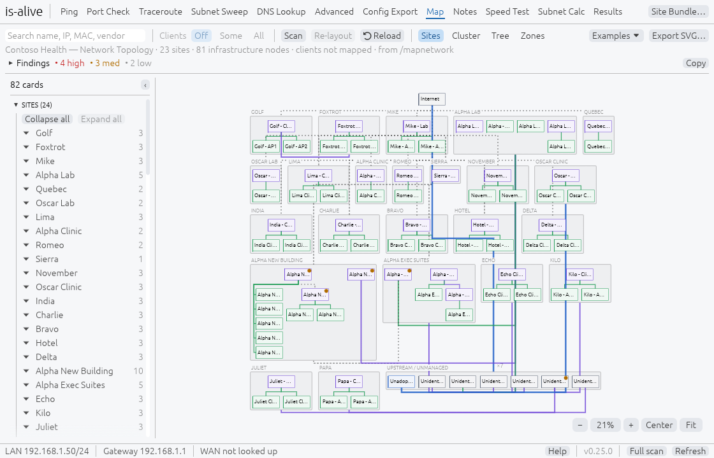

**Emoji** sets how emoji are drawn across the app: **Match theme**, **Monochrome**, **Colour** or **Miami neon**. Emoji added in Notes in a style of their own keep it (see [Notes](#12-notes)).

**Animate** (on by default, in every theme) lets things move: the Map tab pulses after a Full scan, dots flow along the Map's lit links, and in Miami the backdrop and the line under the tabs drift (the RGB line too). Everything pauses while the window isn't in front. Off, the Map tab lights up still instead, a lit path keeps its colours with no dots, and the rest holds still. Turn it off on battery or if motion bothers you.

### Miami backdrop

With the Miami theme, the panels sit over a backdrop: **16-bit sunset scene** (drawn by the app), **Your image…** (a picture of your own with a slow pan; only its location is saved, the picture never leaves the computer), or **None**.

- With **Animate** on (above), the scene moves at 10 frames a second, paused when the window isn't in front.
- **Glow** adds a soft glow to the bright parts.
- **VHS** plays the scene like a worn video tape (needs a graphics card).

The small line under them says what's drawing the backdrop (graphics card or processor) and why.

### Network

- **Look up the public IP on start** (on by default): one DNS query to OpenDNS when the app opens, for the WAN address in the footer. Off, nothing leaves the computer until you run something.
- **Check for updates on start** (on by default): one request to GitHub for the latest version. **Check now** checks at any time and says if you're up to date or why it couldn't check.

### Map

- **Show the accuracy note**: brings back the note above the Map if you closed it.

### Keyboard and mouse

Lists the shortcuts (see [Keyboard and mouse](#17-keyboard-and-mouse)).

### Where settings and notes are kept

The bottom of Settings shows the folder:

- **Windows:** `%APPDATA%\is-alive` (for example `C:\Users\you\AppData\Roaming\is-alive`)
- **Linux:** `~/.config/is-alive`

It holds `settings` (theme and the choices above, plain text), `notes.md` (your notes, redacted), `startup.log` (how each start opened the window), `maps` (saved maps), `map-notes.json` (notes on the live map's and the examples' cards, redacted) and, if you've unredacted a detected value, `notes-allow.json` (the values you chose to keep, in notes or card notes). The window also reopens at the size you last closed it.

**Help wiki** at the top right of Settings opens the wiki.

---

## 17. Keyboard and mouse

| Keys | Where | What it does |
|---|---|---|
| **Ctrl+1** … **Ctrl+9** | Anywhere | Ping, Port Check, Traceroute, Subnet Sweep, DNS Lookup, Advanced, Config Export, Map, Notes |
| **Ctrl+0** | Anywhere | Results |
| **F1** | Anywhere | Open the is-alive wiki (same as **Help**) |
| **Enter** | A tool's field | Start the run |
| **Esc** | While a tool runs | Stop the run |
| **Ctrl+C / Ctrl+X / Ctrl+V / Ctrl+A** | Any text box | Copy, cut, paste, select all (also on the right-click menu) |
| **Ctrl+B / Ctrl+I** | Notes | Bold / italic |
| **Ctrl+R** | Notes, Site Bundle's Known problems, a card's note | Redact the selection, or unredact the value under the cursor |
| **Enter** in a list | Notes | Start the next item (on an empty item, end the list) |
| **Enter** | Map search | Select the first match |
| **Esc** | Map | Clear the selection (pinned cards stay) |
| **N** | Map, one card selected | Write or edit its note |
| **Ctrl+Enter** / **Esc** | A card's note | Save it / leave it as it was |

On a Mac, **⌘** takes the place of **Ctrl**. Speed Test and Subnet Calc have no number shortcut.

| Mouse | Where | What it does |
|---|---|---|
| Drag the background | Map | Pan |
| Scroll / pinch | Map | Zoom |
| Double-click the background | Map | Fit the whole map |
| Double-click a card | Map | Zoom to that card |
| Double-click a card's note mark | Map | Open its note |
| Click a card | Map | Select it and light its path to the internet |
| Ctrl+click or Shift+click a card | Map | Add to or take out of the selection |
| Right-click a card (or ☰ on it in the panel) | Map | Pin, add a note, select related cards, collapse its site, copy (for every selected card, if it's one of several) |
| Drag a card | Map | Move it (and the rest of the selection with it) |
| Click a site's title | Map | Collapse or expand the site |
| Click a role box's title (Zones) | Map | Select its cards (Ctrl/Shift+click: add them) |
| Drag a box's title | Map | Move the box with its cards |
| Right-click a box's title | Map | Select its cards, put the box back, Links |
| Right-click | Any text box | Cut, Copy, Paste, Select all |
| Drop a file on the window | Anywhere | Open it in Config Export |

---

## 18. Site Bundle and Claude

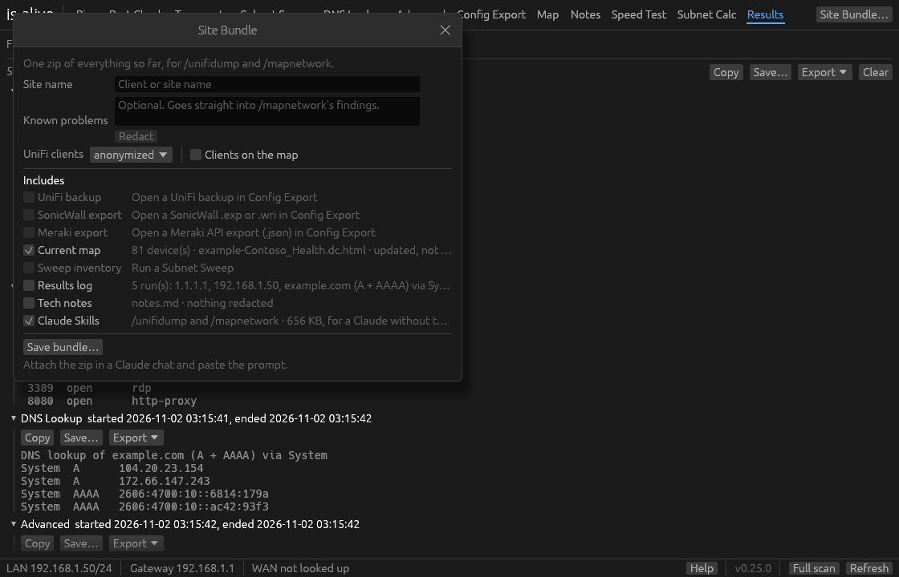

is-alive works with two Claude skills: **`/unifidump`**, which reads a UniFi export, and **`/mapnetwork`**, which builds an accurate, interactive network map and findings from everything you collected. **Site Bundle…** (top right, any tab) gathers it all into one zip.

### The window

| Field | What it's for |
|---|---|
| **Site name** | The client or site; it names the zip (`<site>.bundle.zip`) and the map |
| **Known problems** | Anything you already know is wrong ("Closet 2 switch flaky"). It goes straight into the map's findings. **Redact** works here as in Notes |
| **UniFi clients** | How UniFi clients are included: **anonymized** by default here (MAC, vendor and switch port kept, names replaced with tokens), or **none** or **full** |
| **Clients on the map** | Whether `/mapnetwork` draws end devices (off: infrastructure only) |
| **Includes** | Tick what goes in; each row says what it is, or what to do to have one |

**What can be included:**

| Item | From | Default |
|---|---|---|
| UniFi backup | The UniFi backup open in Config Export, converted again with the bundle's client setting | on when loaded |
| SonicWall export | The SonicWall export or report open in Config Export | on when loaded |
| Meraki export | The Meraki export open in Config Export | on when loaded |
| Current map | The `/mapnetwork` map open in Config Export, from an earlier visit: Claude updates it rather than starting over | on when loaded |
| Sweep inventory | The last finished Subnet Sweep | on when there is one |
| Results log | Every run in Results. Off by default: it can include other clients' hosts and domains, so the row lists its targets for you to check | off |
| Tech notes | The Notes tab, redacted (the row says how much) | off |
| Card notes | The notes on the live map's cards, redacted, each with its card's name, role, IP and MAC (`card-notes.json`) | on when there are any |
| Claude Skills | The two skills themselves (about 650 KB), for a Claude that doesn't have them installed | on |

The bundle also holds `manifest.json` (what each file is, this computer's LAN, gateway and WAN, and the answers to `/mapnetwork`'s questions) and `prompt.txt`, the kickoff prompt.

**Save bundle…** saves the zip and copies the kickoff prompt to the clipboard; **Copy kickoff prompt** copies it again. Only sanitized data goes in: raw backups and secrets never do.

### The round trip

1. **On site:** run a Subnet Sweep, open the site's UniFi backup and SonicWall or Meraki export in Config Export, take notes.
2. **Bundle:** click **Site Bundle…**, fill in the site name and any known problems, and **Save bundle…**.
3. **In Claude:** start a chat, attach the zip and paste (the prompt is already on the clipboard). It tells Claude to read the manifest, run `/unifidump` on the UniFi export, then `/mapnetwork` with everything else.
4. **Back in is-alive:** open the `.dc.html` map Claude makes in Config Export (or drop it on the window). The Map redraws it, and a sweep of the same network marks which devices answer.
5. **Next visit:** keep that map open when you make the next bundle. Claude updates the existing map, under its original name, instead of starting again.

---

## 19. Privacy and security

is-alive was built for sites with regulated data (healthcare, finance): it sends as little as possible and keeps secrets out of everything it writes.

- **On start, two requests, both optional:** the public IP (one DNS query to OpenDNS) and the update check (one HTTPS request to GitHub, carrying only the app's version). Turn both off in **Settings → Network** and opening the app sends nothing at all.
- **Everything else only when you run it.** No telemetry, no accounts, no analytics. Links (Help, the update link, a card's Web button) open in your own browser.
- **Configs are sanitized on this computer** before anything is saved or shared, as described in [Config Export](#10-config-export). Notes and Known problems are redacted as described in [Notes](#12-notes).
- **The clipboard:** on Windows, everything the app copies is kept out of clipboard history (Win+V), cloud clipboard sync and clipboard managers. When the app closes, it clears the clipboard if it still holds the app's last copy.
- **At rest** there are only the settings file, `startup.log` (which renderer opened the window), `notes.md` (redacted) and, if you unredacted a detected value, `notes-allow.json` (the values you chose to keep); the notes files are readable only by your user account. The Results log is in memory and gone when the app closes.
- **Files are treated as untrusted:** only regular files up to 2 GB are read, unpacking is capped, and the readers are tested against damaged and random input.
- **Nothing it writes can run:** a save keeps the type it offers (a name typed as `notes.bat` saves as `notes.bat.txt`), and CSV cells that start with `=`, `+`, `-` or `@` are escaped so Excel shows a hostile hostname as text instead of running it as a formula.
- **Input is checked:** every field limits how much it takes (255 characters for most fields, 2,048 for a link, 1,000,000 characters in Notes, 20,000 characters in Known problems) and what kind of value it accepts, so a stray paste can't swell a field or start a run with nonsense.

**Scanning is visible.** Port Check, Subnet Sweep, Check mgmt ports and Full scan send probes that intrusion detection and endpoint protection may flag. Agree it with the site first; where it's sanctioned, the security team can exclude the tool or your computer.

---

## 20. Troubleshooting

### The .exe doesn't open

- **SmartScreen ("Windows protected your PC"):** click **More info → Run anyway** (see [Download and first start](#windows)).
- **Nothing happens at all:** right-click `is-alive.exe` → **Properties**. If there's an **Unblock** tick box at the bottom of the General tab, tick it and click **OK**. Then check your antivirus hasn't quarantined it (port scanners sometimes get flagged); restore it or ask IT to allow it.
- **An error box about graphics:** is-alive draws its window with OpenGL. If that can't start (a virtual machine, remote desktop, or an old or missing graphics driver), it tries Direct3D 12 instead (works without a graphics card) and keeps using it from then on. If neither works, it shows an error box saying why. Every start is written to `startup.log` in the settings folder (`%APPDATA%\is-alive\startup.log`): send that file with your problem report.
- **To choose the renderer yourself**, start it from a command prompt with `--renderer=wgpu` (Direct3D, Vulkan or Metal) or `--renderer=glow` (OpenGL):

  ```bat
  is-alive.exe --renderer=wgpu
  ```

  A shortcut works too: right-click it → **Properties** → add the option to the end of **Target**. `--renderer=wgpu` is remembered; start once with `--renderer=glow` to go back to OpenGL. The `IS_ALIVE_RENDERER` environment variable works too.

### The AppImage doesn't start (Linux)

- **Nothing happens on double-click:** it isn't executable yet: `chmod +x is-alive-x86_64.AppImage`.
- **"FUSE" or "libfuse.so.2" errors:** run it with `./is-alive-x86_64.AppImage --appimage-extract-and-run`, or install your distribution's FUSE 2 package (`libfuse2` on Ubuntu and Debian).
- **"GLIBC_2.35 not found":** the system is older than Ubuntu 22.04 / Debian 12.

### Ping doesn't work on Linux

is-alive pings without root using the kernel's unprivileged ping sockets, which most distributions allow. If yours doesn't (`net.ipv4.ping_group_range` doesn't include your group), it falls back to the system `ping` command; if that's missing too, every ping says so. Allow it with:

```sh
sudo sysctl -w net.ipv4.ping_group_range="0 2147483647"
```

### Results look wrong

| Symptom | Likely cause |
|---|---|
| Every ping times out, browsing works | ICMP blocked on the way: use **TCP** mode, port 443 |
| Port Check: everything *filtered* | A firewall between you and the device, or the device is off |
| Sweep finds few devices on a remote subnet | Only ping counts past a router, and firewalls drop it |
| Advanced: SMTP says port 25 is probably blocked | The ISP or office firewall blocks outbound mail: normal, not the domain's fault |
| Advanced: blacklists *couldn't check* | Those lists refuse public resolvers: set **Resolver** to the office's DNS |
| Speed Test blocked or 403 | Web filtering, or Cloudflare rate-limiting: use **Download a file** with a server from **Servers** |
| Map empty | Nothing seen yet: **Scan this network**, or open a backup in Config Export |
| Footer WAN says *unknown* | No internet, or OpenDNS blocked; *not looked up* means it's turned off in Settings |
| Security software alerts during a scan | Expected: agree scans with the site and use the **Gentle** speed |

### Help or a link doesn't open the browser

is-alive opens links with the system's own launcher. If nothing happens, check a default browser is set (Windows: **Settings → Apps → Default apps**; Linux: `xdg-settings get default-web-browser`).

### Reporting a problem

Include the version (bottom right), what you ran, and what you saw. **Copy** on the tab, or the run's **Copy** in Results, gives the exact text. For a start-up problem on Windows, attach `startup.log` (`%APPDATA%\is-alive\startup.log`).

---

## 21. Glossary

| Term | Plain meaning |
|---|---|
| **IP address** | A device's number on a network, like a phone number (`192.168.1.20`, `1.1.1.1`) |
| **IPv4 / IPv6** | The old (`192.168.1.1`) and new (`2001:db8::1`) kinds of address; most networks use both |
| **Subnet / CIDR** | A block of addresses written as start/size: `/24` is 256 addresses, `/26` is 64 |
| **Netmask** | The same size written as `255.255.255.0`; a **wildcard** is its inverse (`0.0.0.255`), used in ACLs |
| **Gateway / router** | The device that connects the local network to other networks and the internet |
| **LAN** | The local network in a building |
| **WAN / public IP** | The address the internet sees for the whole network |
| **CGNAT** | Carrier-grade NAT (`100.64.0.0/10`): the provider shares one public address between many customers |
| **VLAN** | A separate network running over the same switches (staff, guests, phones) |
| **MAC address** | A device's hardware address; the first half says who made it |
| **ARP** | How a device finds the MAC address for an IP on the same network |
| **ICMP / ping** | A small "are you there?" message that measures response time |
| **TTL** | A counter in each packet that each router lowers by one; traceroute uses it to find each hop |
| **Latency / RTT** | Time for a message to get there and back, in milliseconds (ms) |
| **Jitter** | How much latency varies from one packet to the next; calls suffer above 30 ms |
| **Packet loss** | Messages that never arrive; calls suffer above 1% |
| **Bufferbloat** | Latency that rises when the line is busy, because too much data is queued |
| **SQM** | Smart queue management (fq_codel, CAKE): keeps latency low on a busy line |
| **MOS** | Mean opinion score: call quality from 1 (bad) to about 4.4 (excellent) |
| **Mbps** | Megabits per second: line speed |
| **TCP port** | A numbered door on a device for one service (443 secure web, 3389 Remote Desktop, 25 mail) |
| **Open / closed / filtered** | A service answers / the device says nothing's there / no answer at all (usually a firewall) |
| **DNS** | The internet's phone book: names to addresses |
| **Resolver** | The DNS server that looks names up for you |
| **Authoritative server** | The DNS server that holds a domain's own records |
| **Split DNS** | A name that gives different answers inside and outside the office |
| **A / AAAA record** | A name's IPv4 / IPv6 address |
| **MX record** | Which servers receive a domain's email |
| **TXT record** | Free text in DNS; SPF, DMARC and verification codes live here |
| **PTR record** | Reverse lookup: address to name |
| **SPF** | The list of servers allowed to send email for a domain |
| **DKIM** | A digital signature on outgoing email proving it wasn't forged |
| **DMARC** | What receivers should do with email that fails SPF and DKIM: nothing, junk it, or reject it |
| **Blacklist (DNSBL)** | A shared list of addresses known for spam; being on one sends mail to junk |
| **DNSSEC** | Signatures on DNS records so answers can't be forged |
| **MTA-STS / TLS-RPT** | Make other mail servers use encryption when sending to a domain / report when they can't |
| **Firewall** | The device that decides what traffic may pass between networks |
| **Switch** | A box with many network sockets that connects wired devices |
| **Access point (AP)** | Provides Wi-Fi |
| **Uplink** | A device's connection towards the internet |
| **LLDP** | How switches, phones and APs tell their neighbours what they are and which port they're on |
| **Markdown** | Plain text with simple marks for formatting (`**bold**`, `- list`, `## heading`) |
| **Redact** | Hide a value (a password) in everything that leaves the app |

---

## 22. Updating this manual

*For maintainers.*

The text is updated with any release that changes what it describes. The **screenshots are updated only for full releases** (x.y.0), so they always match a version people download:

1. Bump the version to x.y.0 in `Cargo.toml` (and `Cargo.lock`) as usual.
2. Run `scripts/manual-shots.sh`. It builds the release binary in the `isalive-dev` container and runs the app's manual tour (`IS_ALIVE_SHOTS_MANUAL`, in `src/shots.rs`) on a made-up network, writing `docs/manual/img/<name>.png`. On a patch version it refuses to touch `docs/manual/img` and says why; `scripts/manual-shots.sh --out <dir>` renders a preview anywhere, at any version.
3. Look at every picture, then commit them with the release.

The tour pings `1.1.1.1`, checks `example.com`, runs a 10-second download from Cloudflare and port-checks a few listeners on its own made-up address (`192.168.1.50`); it never sweeps, traces, looks up the public IP or checks for updates (its Settings has both turned off, so the footer's *WAN not looked up* matches), so the pictures show no real network. The made-up network answers pings itself, so the Ping picture's replies say `ttl=255`.

The pictures are rendered into `docs/manual/img/.incoming` first. A run that fails (a lookup error, a speed test refused with *http status: 429*) is tried once more after 45 seconds; if it still fails, or a run doesn't finish in two minutes, the script says which picture and why, fails, and leaves `docs/manual/img` as it was, with this run's pictures in `.incoming` to look at. A 429 means Cloudflare is rate-limiting your address after several runs: wait an hour and run the script again.

The names the tour writes are the ones this manual links to, and a test (`manual_shows_every_picture_the_tour_takes`) fails if the two lists differ. To add a picture, add a scene to `MANUAL` in `src/shots.rs` and link `img/<name>.png` here.

On a full-release tag, the **manual screenshots** workflow (`.github/workflows/manual-shots.yml`, also runnable by hand) produces the same set as an artifact. GitHub's runners don't pass ping, so the committed pictures come from the local run.
